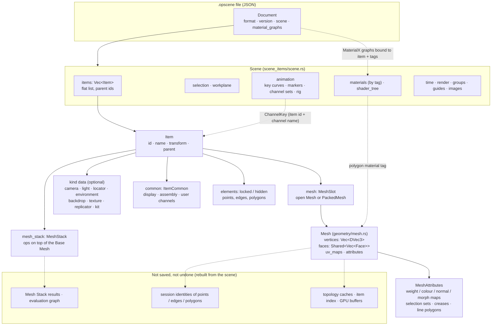

# Data model

What an Operandi scene is made of, in memory and on disk. This is the
"what the data looks like" companion to [ARCHITECTURE.md](ARCHITECTURE.md)
(what each crate does) and [CODEMAP.md](CODEMAP.md) (which file to open).
All of it lives in `operandi-core`; paths below are under
`crates/operandi-core/src/`. Each file's first `//!` lines explain its part
in more detail, and the spec IDs in them (`MO-01`, `TK-50`) find the tests.

The short version: **one `Scene` value holds the whole document.** It is
plain Rust data (it derives `Clone`, `PartialEq`, `Serialize`), the editor
changes it only by running a `Command`, undo keeps earlier copies of it,
and a save writes it out as JSON. Big arrays inside it are shared
copy-on-write, so copies are cheap.

## The picture



Solid arrows are "contains". Dotted arrows are "refers to by id or name"
or "is computed from".

## Scene and items

`Scene` (`scene_items/scene.rs`) is the document. Its main fields:

| Field | Holds |
|---|---|
| `items` | Every item, in one flat `Vec<Item>`. |
| `next_id` | The next item id to hand out. Ids are never reused. |
| `selection` | The current selection (see [Selections](#selections)). |
| `workplane` | The work plane. |
| `materials` | The material for each polygon material tag (`Default` is untagged polygons). |
| `shader_tree` | Surfacing, shading and render-output layers. |
| `animation` | Key curves, time settings, markers, channel sets and the rig. |
| `time` | Frame rate, time range, current time. |
| `render`, `render_camera` | Final-render settings and which camera renders. |
| `groups` | Named item groups (lists of item ids). |
| `guides`, `images`, `smoothing`, `item_draw_size` | Guides, Backdrop images, default smoothing, item drawing size. |

A few fields are marked `#[serde(skip)]`: they live on the scene for
convenience but are never saved (the item index, the "last active mesh",
paint pixels, MaterialX pins). A scene opened from a file rebuilds them.

### Items and the hierarchy

An `Item` is one entry in the Items list. Every item, whatever its kind,
has the same struct:

- `id: u64` (stable for the item's life), `name`, `visible`, `transform`
  (`translation`, `rotation` in radians, `scale`, and the rotation order).
- `parent: Option<u64>`: the hierarchy. There is no tree structure in
  memory: `items` is flat and each item names its parent's id (`None` is a
  root). Siblings keep their order in `items`, so list order is the order
  you see. `Scene` has helpers that walk this as a tree (for example the
  "every item id in tree order" walk), and `scene_index.rs` remembers
  where each id sits in the list.
- `mesh: MeshSlot`: every item has a mesh slot. For a mesh item it holds
  the geometry; for other kinds it stays empty.
- **Kind data**, one optional field per kind: `camera`, `light`,
  `locator`, `environment`, `backdrop`, `texture`, `replicator`, `kit`.
  An item with none of them set is a mesh item. `instance_of` makes it a
  Mesh Instance that shows another item's mesh. `kit` holds an item of a
  kind a kit adds, kept and saved unchanged even when that kit isn't
  installed.
- `common: ItemCommon`: the tabs every item shares (Display, Assembly,
  targeting, editor colour) and `extras`, which holds the item's **user
  channels** and tags.
- `subdivision`, `multires`, `mesh_stack`, `elements`: see below.

Item groups (`item_groups.rs`) are not part of the hierarchy: a group is a
name and a list of member ids, so one item can be in several.

## Meshes

### Points and polygons

`Mesh` (`geometry/mesh.rs`) is deliberately simple:

```rust
pub struct Mesh {
    pub vertices: Vec<DVec3>,                 // point positions, f64
    pub faces: Shared<Vec<Face>>,             // polygons
    pub uv_maps: Shared<BTreeMap<String, Vec<Vec<Option<DVec2>>>>>,
    pub attributes: Shared<MeshAttributes>,   // everything else
}

pub struct Face {
    pub vertices: Vec<u32>,     // point indices, in winding order
    pub material: String,       // material tag ("" = Default)
    pub part: Option<String>,   // part tag
    pub smooth: bool,
    pub uv: Option<Vec<DVec2>>, // older single UV list, one per corner
    pub material_label: Option<String>,
}
```

- **Points** are an index into `vertices`. Indices are `u32`.
- **Polygons** are an index into `faces`. A polygon is its list of point
  indices; any number of sides (n-gons are normal).
- **Corners** (a polygon's use of one point) have no list of their own: a
  corner is "polygon *p*, position *k* in its point list". Per-corner data
  is stored as a list per polygon, with one entry per corner.
- **Edges are not stored.** An edge is a pair of point indices, written
  low index first (`geometry/topology.rs`, `edge_key`), so both directions
  name the same edge. The edge list is worked out from the polygons when a
  tool needs it and remembered between frames (`topology_cache.rs`). Edge
  data (creases, edge selection sets) is keyed by that point pair.
- **Lines** (open and closed curves drawn as polygons) are polygons too;
  `MeshAttributes::representations` says which polygons are surfaces,
  subdivision cages or lines.
- Limits: at most 100 million points and 100 million polygons per mesh
  (`MAX_MESH_ELEMENTS`). `Mesh::validate` checks every index is in range,
  no polygon repeats a point, and every per-corner list matches its
  polygon's size.

Because points and polygons are found by their position in a list,
deleting or reordering geometry renumbers them. Code that needs to follow
"the same point" across an edit uses the session identities below, never
the index.

### Maps and selection sets

`MeshAttributes` (`geometry/mesh_attributes.rs`) holds the rest, each map
by name:

| Kind | Stored as |
|---|---|
| UV maps | `Mesh::uv_maps`: per polygon, per corner, `Option<DVec2>` (unmapped corners are `None`). `point_uvs` holds point-based UVs. `current_uv_map` names the active one. |
| Weight maps | `point_weights` (point → value) and `corner_weights` (per corner). |
| Colour maps | `point_colors` and `corner_colors` (RGBA). |
| Normal maps | `corner_normals`, in `normal_map_order`. |
| Morphs | `relative_morphs`: point → offset from the base position. |
| Other typed maps | `typed_maps`: a kind name, a dimension and values per point or per corner. |
| Selection sets | `vertex_sets`, `edge_sets`, `polygon_sets` (name → set of indices or point pairs) and `set_groups`. |
| Edge creases | `creases`: point pair + weight. |
| Smoothing and lines | `smoothing_labels`, `representations`. |

Point maps use a `BTreeMap<u32, …>`, so a point with no value takes no
space. Because selection sets live inside the mesh, they are saved with it
and undo restores them like any other geometry.

### Shared and packed storage

Two things keep big meshes cheap to copy:

- **`Shared<T>`** (`geometry/shared.rs`) is copy-on-write: cloning it is a
  reference count, and the first change copies the data only if someone
  else still holds it. A drag that only moves points makes a new
  `vertices` list but shares `faces`, `uv_maps` and `attributes` with the
  version before it.
- **`MeshSlot`** (`geometry/mesh_slot.rs`) is what an item actually holds.
  It keeps a mesh **open** (the `Mesh` above) or **packed** (`PackedMesh`,
  `geometry/packed_mesh.rs`: a few flat arrays instead of one heap object
  per polygon), or both while they match. Reading through it looks like a
  `Mesh`; code that only looks should use `read()`, which works on either
  form without unpacking. Packing is exact, bit for bit. Each slot carries
  a content stamp that changes only when the contents may have changed, so
  caches key on the stamp.

### Session identities

`scene_items/identity.rs` gives points, edges, corners and polygons ids
(`VertexId`, `EdgeId`, …) that survive an edit when the edit says how old
elements map to new ones. They exist for the current session only: they
are not saved, and an edit that doesn't describe its mapping simply gives
that mesh fresh ids. The MCP bridge and selection-following code use them.

### Locked and hidden geometry

`Item::elements` (`selections/element_state.rs`) holds the points, edges
and polygons that are locked (saved) or hidden (not saved). The editor
applies them once after every command, so tools don't check them
themselves.

### Subdivision and multires

`Item::subdivision` holds the subdivision level and rules; the
subdivided surface itself is computed, not stored. `Item::multires`
(`sculpting/multires.rs`) holds a multiresolution sculpt: the base cage,
which level `mesh` currently shows and each level's detail.

## The Mesh Stack

`meshops/mesh_stack.rs`. When `Item::mesh_stack` is set, `Item::mesh` is
the **Base Mesh** and the stack is a list of operations run on top of it:

```rust
pub struct MeshStack { pub ops: Vec<MeshOp>, pub next_id: u64 }
pub struct MeshOp {
    pub id: u64,
    pub enabled: bool,
    pub kind: OpKind,                    // which op, and its values
    pub selection: Option<SelectByIndex>,
    pub selops: Vec<SelOp>,              // what it acts on
}
pub enum OpKind {
    Op { type_id: String, values: serde_json::Value },
    Placeholder { type_id, version, values, reason }, // unknown op, kept as-is
}
```

- An op's values are JSON, read and checked by its type's entry in the op
  table (`meshop_types.rs`). Built-in types are in
  `mesh_stack_builtin.rs`; kits add their own at run time. An op whose type
  this build doesn't know becomes a `Placeholder`: it passes its input
  through and saves back unchanged.
- The stack is the **recipe**, and it is what is saved and undone. The
  **result** (the mesh the viewport, renders and exports show) is computed
  by the runtime, cached per op, and never stored in the scene, the undo
  history or the file. The same recipe always gives the same mesh.
- Ops can read other items (Merge Meshes, Boolean). Those links are item
  ids; loops are refused.

The evaluation graph (`meshops/eval_graph.rs`) tracks what reads what
(a channel's value now, an item's shown mesh) so only out-of-date results
are recomputed. It is a cache built from the scene: never saved, never
undone.

## Channels and animation

### Channels

A **channel** is one named value of an item or shader-tree layer:
`pos.X`, `rot.Y`, `scl.Z` for transforms, and names like `visible`,
`color.r` or a light's intensity for everything else. `anim/channels.rs`
has one table per kind of thing, each row saying the channel's name, its
type, how to read it and the one `Command` that sets it. Channels are a
**view onto fields that already exist** (an item's `transform`, a light's
settings), not a separate store, so adding a channel means adding a table
row. Units at this boundary: metres, radians, and 0 to 1 for percents.

**User channels** (`scene_items/item_extras.rs`, `UserChannel`) are the
exception: values the user adds to an item, stored on the item in
`common.extras.channels` with a name, type, value and optional min/max.

### Keys and curves

Time is exact: `anim/time_tick.rs` counts whole `Tick`s
(254,016,000,000 per second), which divides evenly into every common frame
rate, and a `FrameRate` is a fraction. Nothing drifts by rounding.

`Scene::animation` (`anim/animation.rs`) holds:

- `channels: BTreeMap<ChannelKey, AnimChannel>`. A `ChannelKey` is an item
  id plus a channel name. An `AnimChannel` is a key `Curve` plus the
  channel's **rest** value (its value before it was first keyed).
- A `Curve` (`anim/anim_curve.rs`) is a list of `Key`s sorted by time,
  each with a value, in and out slope types, manual slopes and weights,
  plus the curve's stepped flag and before/after behaviour.
- `settings`, `markers`, `channel_sets` (the channel panel's lists of
  channels), `shadows` (graph editor shadow curves) and `rig` (rig pieces,
  pivots and IK; joints themselves are items).

Where a value lives, in one rule: **the item's own field always holds the
value at the current time.** Every tool, panel, render and export reads
that field. Moving the current time "poses" the scene, writing each
curve's value into its field. A field that differs from its curve is an
edit that hasn't been keyed yet; the next time change replaces it unless it
is keyed. `animation::evaluate_at` gives the pose at another time as a
copy, without touching the document.

## Materials

Three layers, from what the user edits to what is kept:

1. **Polygon tags.** A polygon names its material by tag
   (`Face::material`, and `Face::part` for parts). Tags are plain strings
   on each polygon.
2. **The Shader Tree** (`materials/shader_tree.rs`), one per scene: a flat
   list of layers (materials, textures, groups, render outputs), each with
   a parent and its order among siblings. Groups are masked to items,
   tags or selection sets. `Scene::materials` (`materials/material.rs`) is
   the simpler table of base settings by tag that the tree mirrors.
3. **MaterialX graphs: the saved master copy** (`materialx/saved.rs`,
   [MATERIALX_GRAPHS.md](MATERIALX_GRAPHS.md)). A save writes every
   distinct surface the polygons render with as a MaterialX graph, plus a
   table of **bindings**: which item, material tag, part tag and selection
   sets use which graph. The Shader Tree's layers are saved beside them as
   the layout of the view.

On open, the graphs are the truth. Where the layers would now give a
different surface than the saved graph (a file from a build whose sums
differed, or a graph edited in another program), the saved graph is
**pinned** to those polygons and renders and exports use it, until the
user edits the layers that shade them. The pins are session data
(`Scene::material_pins`, not saved as such). Older files without graphs
open from their layers and gain graphs on their next save.

## Selections

`Scene::selection` holds:

- `mode`: Vertex, Edge, Polygon or Item.
- `item`: the active (primary) item, and `also`: the other selected items.
- `vertices: Vec<u32>`, `edges: Vec<(u32, u32)>`, `faces: Vec<u32>`: the
  active mesh's selected elements, by index (edges by point pair).
- `others`: selected elements on other meshes when several are active.

The selection is part of the scene, so it is saved, and selection
changes are undo steps (a run of them can be grouped into one, a
preference). Named selection sets are a different thing: they are stored
inside the mesh (see [Maps and selection sets](#maps-and-selection-sets)).

## Undo and history

Every change to the document is a `Command` (`editor/command.rs`) run by
`Editor::dispatch`. One finished command, or one gesture, is one undo
step.

An undo step is a **checkpoint**: the whole `Scene` as it was **before**
and **after** the step, its label, and the command lines that made it
(`commands/command_record.rs`). Undo puts the "before" scene back, redo
puts the "after" scene back. There are no per-tool undo functions and no
diffs to replay, which is why every command gets undo for free.

That would be expensive if each checkpoint copied every mesh. It doesn't:
thanks to `Shared` and `MeshSlot`, two checkpoints that didn't change a
mesh point at the same mesh data, and a step that only moved points shares
its polygons and maps with the step before it. `commands/undo_memory.rs`
counts the bytes each step alone keeps alive; the history keeps up to the
Max Undo Level (100 by default) and trims the oldest steps when it passes
its memory budget.

What undo does **not** restore, on purpose:

- **The current time.** Undo keeps the time you are at.
- **Paint pixels.** Painted images aren't undone.
- **View state**, such as Setup mode or which channel set is showing.
- Anything computed: Mesh Stack results, caches, GPU buffers.

Inside an open tool, Undo first takes back the tool's own last tweak and
keeps the tool open; only when the tool has none left does it close the
tool and fall through to ordinary steps.

The undo history belongs to the open scene (one per scene tab) and is
never saved in the file. The command records it keeps are also what the
Command History panel shows.

## The .opscene file

`commands/persistence.rs`. A native scene file is pretty-printed JSON:

```json
{
  "format": "Operandi",
  "version": 66,
  "scene": { "items": [ … ], "next_id": 12, "selection": { … }, … },
  "material_graphs": { "graphs": [ … ], "bindings": [ … ] }
}
```

- `scene` is the `Scene` struct written by serde, field for field. So the
  Rust structs above **are** the file format; their `#[serde(...)]`
  attributes are the rules. Most fields are left out when they hold their
  default value, so a simple scene stays small and readable.
- `deny_unknown_fields` is on throughout: a file with a field this build
  doesn't know is refused cleanly instead of losing data.
- **Versions.** Each new kind of saved data gets a version number
  (`CURRENT_VERSION`, 66 today: channel sets). A save writes the **lowest**
  version that can hold what the scene actually uses, so a scene that uses
  nothing new still opens in older builds. A file newer than the build
  reading it is refused.
- **Big arrays are packed** (`geometry/mesh_pack.rs`). A mesh's points,
  polygons or UV map with 1,024 or more entries is written as
  `{"packed": …, "count": N, "blobs": {…}}`, each blob base64 of
  little-endian numbers, so values come back bit for bit. Smaller ones stay
  plain JSON arrays. Readers take either form.
- **Not inside the file:** painted image pixels (saved as image files of
  their own), the undo history, session identities and every computed
  result.
- **Safe saving.** Every save goes through `operandi-files`: the new file
  is written beside the old one, flushed to disk, then renamed over it in
  one step. A failed save leaves the old file untouched.
- **Safe loading.** Reading checks packed array lengths and string
  indices, then runs `Scene::validate` (every index in range, every map
  the right size). A bad file is refused and the open scene is kept.

Presets are the same format: a cut-down scene file with an extra `preset`
header.

Other formats (OBJ, glTF, FBX, USD, LXO and the rest) are importers and
exporters that convert to and from this `Scene`; see
[FILE_FORMATS.md](FILE_FORMATS.md).

## Rules of thumb for contributors

- **Change the scene only through a `Command`.** That is what gives you
  undo, the command history, scripting and the MCP bridge in one go.
- **Adding a saved field:** give it `#[serde(default, skip_serializing_if
  = …)]` so older files still load and scenes that don't use it don't
  change, then add a native version for it in `persistence.rs` (and a
  `has_vNN_…` check so only scenes that use it get the new number).
- **Computed data stays out of `Scene`.** If it can be rebuilt from the
  scene, keep it in a cache or the runtime, so it never lands in undo or
  the file.
- **Don't hold point or polygon indices across edits.** They renumber.
- **Read meshes with `read()`** when you only look, so packed meshes
  aren't unpacked for nothing.
