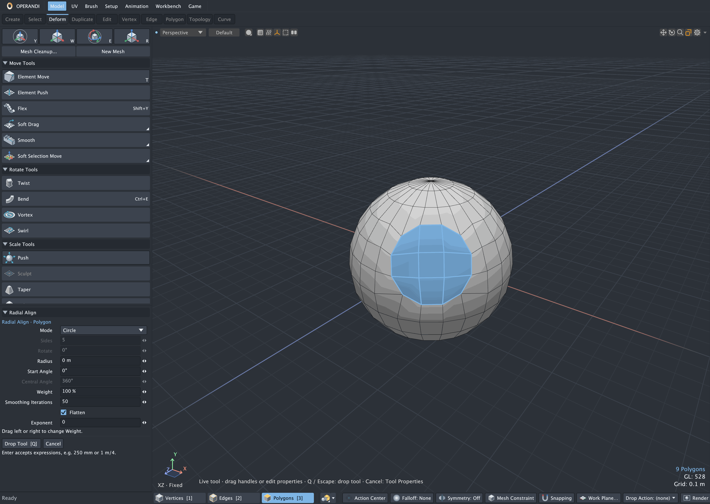

<!-- help-ids: Radial Align, Linear Align ; template: tool ; since: 0.1.0 -->
# Radial Align and Linear Align

**Radial Align** puts the selected loop, points or polygon border on a circle, an arc or a regular polygon. **Linear Align** lines up each selected run between its two end points.

## Radial Align

1. Select a loop of edges or points, or polygons (their border is used).
2. Click **Radial** in the **Align Tools** section of the **Deform** tool tab.
3. Drag left or right to change **Weight**, or set the shape in **Tool
   Properties**.
4. Press **Q**, or click **Drop Tool**, to keep the change and close the tool. **Cancel** takes it back.

### Properties

| Name | What it does | Default |
|---|---|---|
| **Mode** | **Circle**, **Arc** or **N-Sided** (a regular polygon). | Circle |
| **Sides**, **Rotate** | **N-Sided**: how many sides, and how far it is turned. | 5, 0° |
| **Radius** | The circle's radius; 0 fits it to the selection. | 0 m |
| **Start Angle**, **Central Angle** | Where the shape starts, and how far an **Arc** goes round. | 0°, 360° |
| **Weight** | How far points move toward the shape: 100% all the way. | 100% |
| **Smoothing Iterations** | How much the points are evened out along the shape. | 50 |
| **Flatten** | Flattens the points onto the shape's plane. | On |
| **Exponent** | Bends the spacing of the points along the shape. | 0 |

## Linear Align

1. Select an open run of edges or points (a closed loop has no ends to line
   up between).
2. Click **Linear** in the **Align Tools** section.
3. Press **Q**, or click **Drop Tool**, to keep the change and close the tool. **Cancel** takes it back.

### Properties

| Name | What it does | Default |
|---|---|---|
| **Mode** | **Line** (straight between the run's ends) or **Curve** (a smooth curve through the run). | Line |
| **Uniform** | Spaces the points evenly; off, each moves to its nearest spot on the line. | On |
| **Weight** | How far points move toward the line. | 100% |
| **Flatten** | Flattens the run. | On |
| **Align Length**, **Edge Length** | Resizes every run to **Edge Length** (0: the last run's length). | Off, 0 m |

## Related

- [Deform tab](index.md): what the Deform tools have in common
- [Quick Align](../modeling/quick-align.md)
- [Ground Align](../modeling/ground-align.md)
