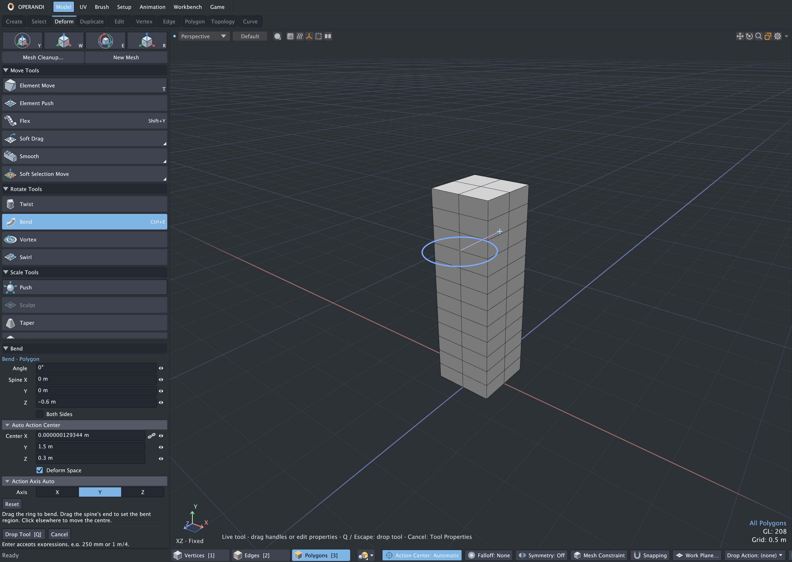

<!-- help-ids: Bend, xfrm.bend ; template: tool ; since: 0.1.0 -->
# Bend

**Bend** curls the selection into an arc about the action centre, like bending a pipe.

## How to use

1. Select what you want to change, or nothing to work on the whole mesh.
2. Click **Bend** in the **Rotate Tools** section of the **Deform** tool tab (key **Control+E**).
3. Click in the view to place the tool (and its falloff) there.
4. Drag the ring to bend. Drag the end of the spine to set how much of the
   mesh bends; click elsewhere to move the centre.
5. Press **Q**, or click **Drop Tool**, to keep the change and close the tool. **Cancel** takes it back.

## Properties

| Name | What it does | Default |
|---|---|---|
| **Angle** | How far the bend turns at the spine's end; points nearer the centre turn less, none at the centre. | 0° |
| **Spine** | The spine, as a direction and length from the centre to its end. | from the selection |
| **Both Sides** | Also bends the points behind the centre, as a mirror image. | Off |
| **Center** | The action centre: where the bend starts. | where you click |
| **Deform Space** | Works out the axis from the mesh as shown deformed. | On |
| **Axis** | The axis the bend curls round. | Y |

**Reset** puts the bend back to its starting values.

## Related

- [Deform tab](index.md): what the Deform tools have in common
- [Twist](twist.md)
