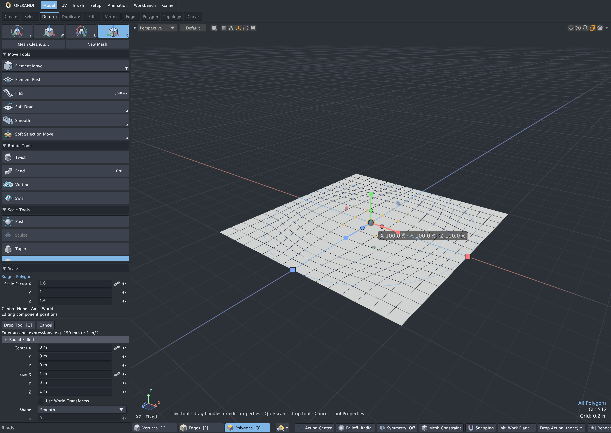

<!-- help-ids: Bulge, xfrm.pole ; template: tool ; since: 0.1.0 -->
# Bulge

**Bulge** scales with a round, smooth falloff: it swells or pinches the middle and leaves the edges alone.

## How to use

1. Select what you want to change, or nothing to work on the whole mesh.
2. Click **Bulge** in the **Scale Tools** section of the **Deform** tool tab.
3. Click in the view to place the tool (and its falloff) there.
4. Drag the scale handles, or type **Scale Factor**: more than 1 swells,
   less than 1 pinches.
5. Press **Q**, or click **Drop Tool**, to keep the change and close the tool. **Cancel** takes it back.

## Properties

| Name | What it does | Default |
|---|---|---|
| **Scale Factor** | The scale along X, Y and Z at full falloff strength. | 1 |
| **Center**, **Size** | The falloff's centre and its radius along X, Y and Z. | fitted to the selection |
| **Use World Transforms** | Places the falloff in world space rather than the mesh's own. | Off |
| **Shape** | How the effect fades from the middle. | Smooth |

## Related

- [Deform tab](index.md): what the Deform tools have in common
- [Taper](taper.md)
