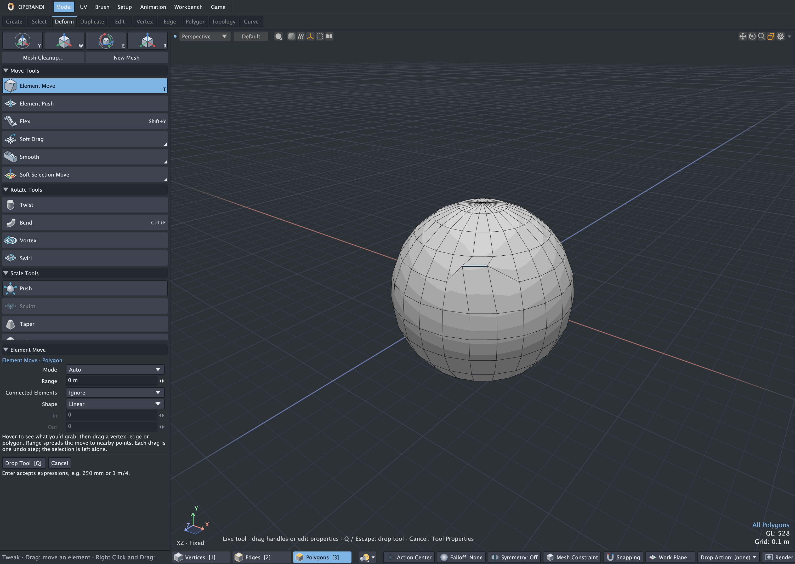

<!-- help-ids: Element Move, ElementMove, Tweak ; template: tool ; since: 0.1.0 -->
# Element Move

**Element Move** drags a single point, edge or polygon, whatever is under the pointer; **Range** spreads the move to its neighbours.

## How to use

1. Select what you want to change, or nothing to work on the whole mesh.
2. Click **Element Move** in the **Move Tools** section of the **Deform** tool tab (key **T**).
3. Rest the pointer on a point, edge or polygon: it lights up.
4. Drag it. Each drag is one undo step, and the selection is left as it was.
5. Press **Q**, or click **Drop Tool**, to keep the change and close the tool. **Cancel** takes it back.

Right-drag in the view to change **Range**.

## Properties

| Name | What it does | Default |
|---|---|---|
| **Mode** | What a drag grabs: **Auto** (whatever is nearest), **Auto Center**, **Vertex**, **Edge**, **Edge Center**, **Polygon** or **Polygon Center**. | Auto |
| **Range** | How far the move spreads to nearby points; 0 moves only the element. | 0 m |
| **Connected Elements** | Which nearby points the range reaches: **Ignore** (any within range), **Use Connectivity**, **Rigid Connections** (the whole piece moves as one) or **Edge Loops**. | Ignore |
| **Shape**, **In**, **Out** | How the move fades over **Range**. | Linear |

## Related

- [Deform tab](index.md): what the Deform tools have in common
- [Selection modes](../selection/selection-modes.md)
