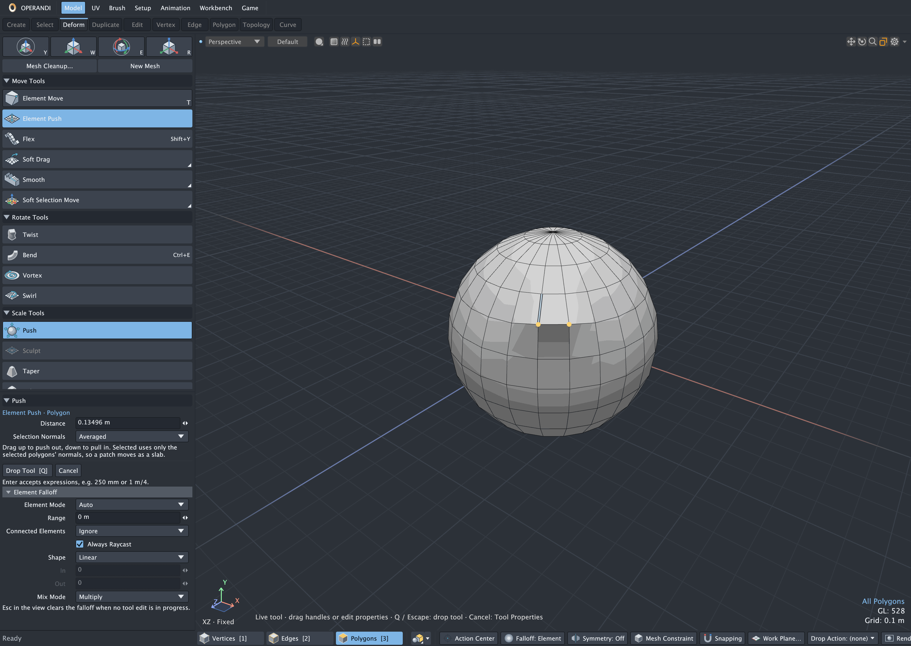

<!-- help-ids: Element Push, ElementPush ; template: tool ; since: 0.1.0 -->
# Element Push

**Element Push** pushes the point, edge or polygon under the pointer straight out along its normal, or pulls it in.

## How to use

1. Select what you want to change, or nothing to work on the whole mesh.
2. Click **Element Push** in the **Move Tools** section of the **Deform** tool tab.
3. Press on a point, edge or polygon and drag up to push it out, down to
   pull it in.
4. Press **Q**, or click **Drop Tool**, to keep the change and close the tool. **Cancel** takes it back.

## Properties

| Name | What it does | Default |
|---|---|---|
| **Distance** | How far the element moves along its normal. | 0 m |
| **Selection Normals** | **Averaged**: each point moves along its own averaged normal. **Selected**: only the selected polygons' normals count, so a patch moves as a slab. | Averaged |
| **Element Mode** | What a press grabs, as in [Element Move](element-move.md). | Auto |
| **Range** | Spreads the push to the element's neighbours. | 0 m |
| **Connected Elements** | Which neighbours **Range** reaches. | Ignore |
| **Always Raycast** | Picks the element under the pointer on every press. | On |
| **Shape**, **Mix Mode** | How the push fades, and how this falloff mixes with others. | Linear, Multiply |

## Related

- [Deform tab](index.md): what the Deform tools have in common
- [Selection modes](../selection/selection-modes.md)
- [Element Move](element-move.md)
