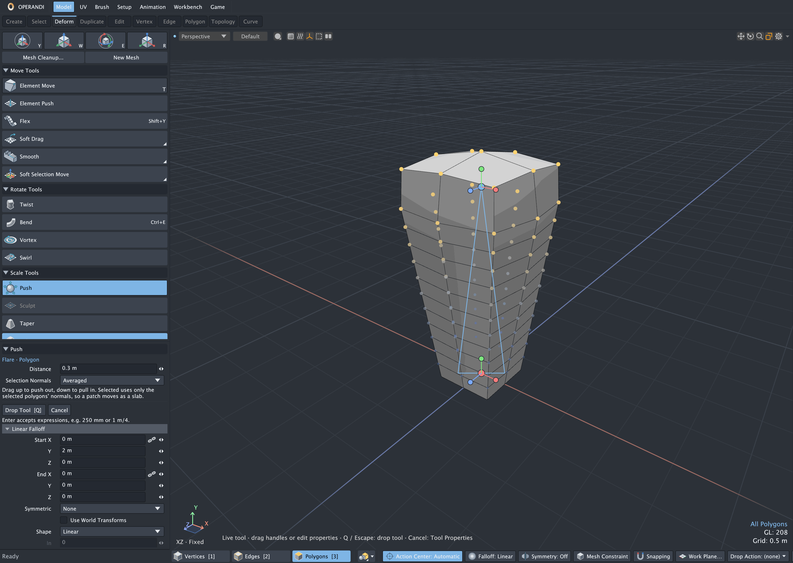

<!-- help-ids: Flare ; template: tool ; since: 0.1.0 -->
# Flare

**Flare** pushes with a straight falloff fitted to the selection: one end swells out, the other stays.

## How to use

1. Select what you want to change, or nothing to work on the whole mesh.
2. Click **Flare** in the **Scale Tools** section of the **Deform** tool tab.
3. Click in the view to place the tool (and its falloff) there.
4. Drag up to swell, down to shrink, or type **Distance**.
5. Press **Q**, or click **Drop Tool**, to keep the change and close the tool. **Cancel** takes it back.

## Properties

| Name | What it does | Default |
|---|---|---|
| **Distance** | How far points move along their normals at full strength. | 0 m |
| **Selection Normals** | **Averaged** or **Selected** (only the selected polygons' normals, so a patch moves as a slab). | Averaged |
| **Start**, **End** | Where the falloff is full (Start) and where it reaches nothing (End). | fitted to the selection |
| **Symmetric** | Mirrors the falloff about its middle. | None |
| **Use World Transforms** | Places the falloff in world space rather than the mesh's own. | Off |
| **Shape** | How the effect fades from Start to End. | Linear |

## Related

- [Deform tab](index.md): what the Deform tools have in common
- [Push](push.md)
- [Taper](taper.md)
