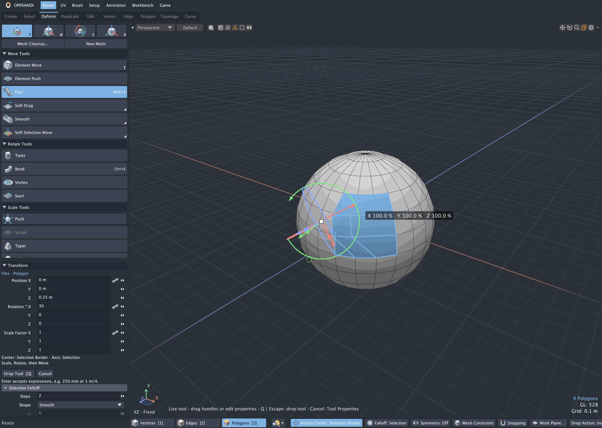

<!-- help-ids: Flex ; template: tool ; since: 0.1.0 -->
# Flex

**Flex** bends the selection about its border, the way a limb bends at a joint: the border stays put and the selection turns, stretches or moves, fading in from the border.

## How to use

1. Select what you want to change, or nothing to work on the whole mesh.
2. Click **Flex** in the **Move Tools** section of the **Deform** tool tab (key **Shift+Y**).
3. Drag the handles: the rings turn the selection, the arrows move it and
   the boxes scale it. The pivot sits on the selection's border.
4. Press **Q**, or click **Drop Tool**, to keep the change and close the tool. **Cancel** takes it back.

## Properties

| Name | What it does | Default |
|---|---|---|
| **Position**, **Rotation**, **Scale Factor** | The move, turn and scale, along X, Y and Z. | 0 m, 0°, 1 |
| **Steps** | How many rows in from the selection's border the falloff takes to reach full strength. | 2 |
| **Shape** | How the effect fades in from the border. | Smooth |

It is **Transform** with a **Selection** falloff, the pivot on the selection's border and the axes along the selection.

## Related

- [Deform tab](index.md): what the Deform tools have in common
- [Selection modes](../selection/selection-modes.md)
- [Soft Selection tools](soft-selection.md)
