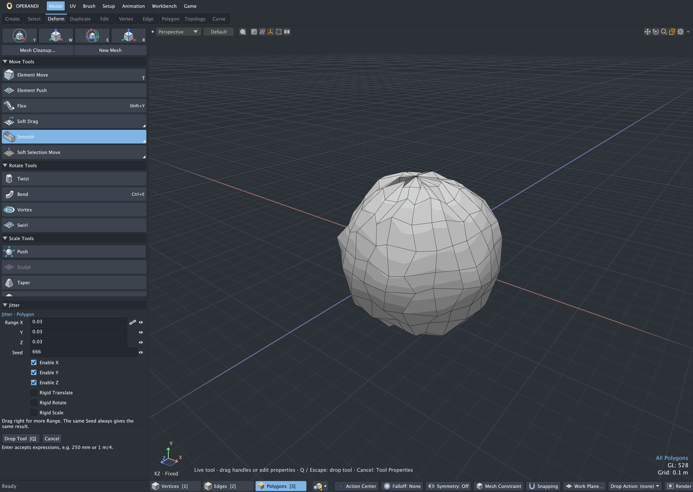

<!-- help-ids: Jitter, xfrm.jitter ; template: tool ; since: 0.1.0 -->
# Jitter

**Jitter** moves each point by a random amount, up to **Range**, for a rough or hand-made look.

## How to use

1. Select what you want to change, or nothing to work on the whole mesh.
2. Click **Jitter** in the **Move Tools** section of the **Deform** tool tab.
3. Drag right in the view for more **Range**, or type it.
4. Press **Q**, or click **Drop Tool**, to keep the change and close the tool. **Cancel** takes it back.

The same **Seed** always gives the same result, so you can undo, change
**Range** and get the same pattern back, bigger or smaller.

## Properties

| Name | What it does | Default |
|---|---|---|
| **Range** | The largest move along X, Y and Z. | 0 m |
| **Seed** | Picks the random pattern. | 666 |
| **Enable X**, **Y**, **Z** | Which axes points may move along. | On |
| **Rigid Translate** | Moves each connected piece as one block instead of each point. | Off |
| **Rigid Rotate**, **Rigid Scale** | Turns or resizes each connected piece about its centre. | Off |

## Related

- [Deform tab](index.md): what the Deform tools have in common
- [Selection modes](../selection/selection-modes.md)
- [Quantize](quantize.md)
