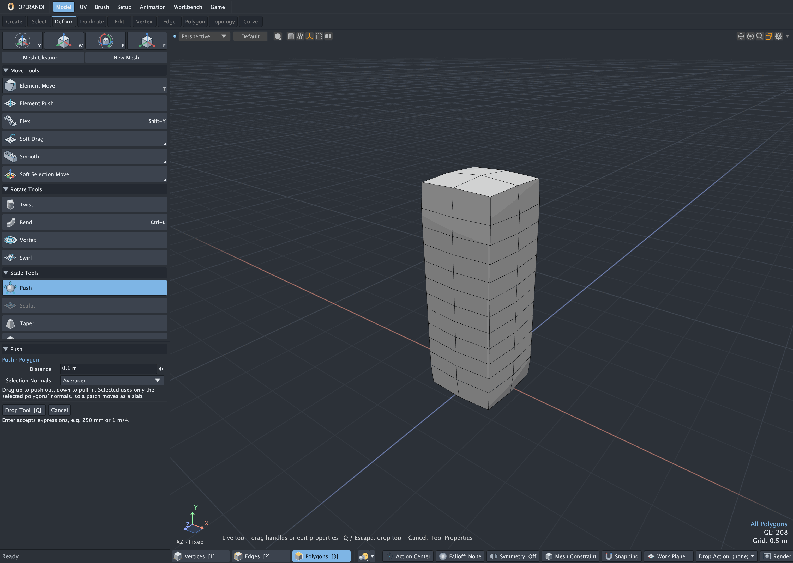

<!-- help-ids: Push ; template: tool ; since: 0.1.0 -->
# Push

**Push** moves points along their normals: out to inflate, in to shrink.

## How to use

1. Select what you want to change, or nothing to work on the whole mesh.
2. Click **Push** in the **Scale Tools** section of the **Deform** tool tab.
3. Click in the view to place the tool (and its falloff) there.
4. Drag up to push out, down to pull in, or type **Distance**.
5. Press **Q**, or click **Drop Tool**, to keep the change and close the tool. **Cancel** takes it back.

## Properties

| Name | What it does | Default |
|---|---|---|
| **Distance** | How far points move along their normals at full strength. | 0 m |
| **Selection Normals** | **Averaged** or **Selected** (only the selected polygons' normals, so a patch moves as a slab). | Averaged |

## Related

- [Deform tab](index.md): what the Deform tools have in common
- [Element Push](element-push.md)
- [Flare](flare.md)
