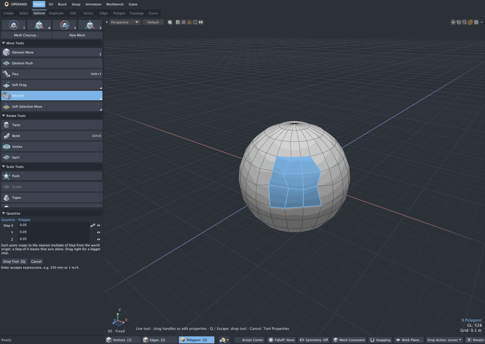

<!-- help-ids: Quantize, xfrm.quantize ; template: tool ; since: 0.1.0 -->
# Quantize

**Quantize** snaps points to a grid: each one moves to the nearest multiple of **Step** from the world origin.

## How to use

1. Select what you want to change, or nothing to work on the whole mesh.
2. Click **Quantize** in the **Move Tools** section of the **Deform** tool tab.
3. Type **Step**, or drag right in the view for a bigger step.
4. Press **Q**, or click **Drop Tool**, to keep the change and close the tool. **Cancel** takes it back.

## Properties

| Name | What it does | Default |
|---|---|---|
| **Step** | The grid's spacing along X, Y and Z; 0 leaves that axis alone. | 0 m |

## Tips

- A step that is large compared with the polygons can collapse polygons
  to nothing (on a sphere, round its poles). Operandi refuses that edit and
  says which polygon would collapse; use a smaller step, or select less.

## Related

- [Deform tab](index.md): what the Deform tools have in common
- [Selection modes](../selection/selection-modes.md)
- [Jitter](jitter.md)
