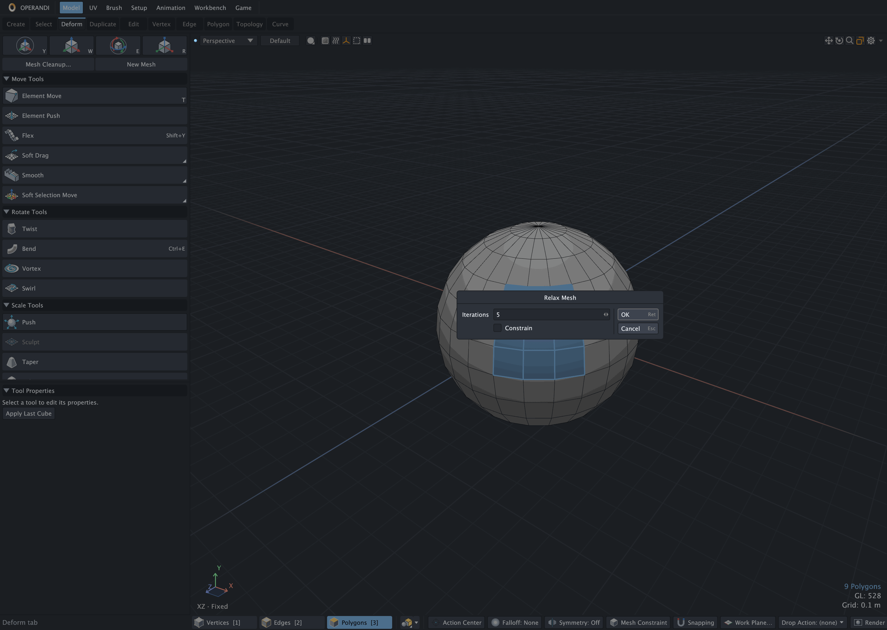

<!-- help-ids: Relax Mesh ; template: tool ; since: 0.1.0 -->
# Relax Mesh

**Relax Mesh** evens out the selected points, so the polygons become more regular; open borders stay put.

## How to use

1. Select the points or polygons to relax, or nothing to relax the whole
   mesh.
2. Click **Relax Mesh...** in the **Commands** section of the **Deform**
   tool tab.
3. Set the options and click **OK**. It is one undo step.

## Options

| Name | What it does | Default |
|---|---|---|
| **Iterations** | How many relax passes to run, 1 to 1000. | 5 |
| **Constrain** | Relaxes against the fixed border until the points settle: a stronger, flatter result. | Off |

## Related

- [Deform tab](index.md): what the Deform tools have in common
- [Smooth](smooth.md)
