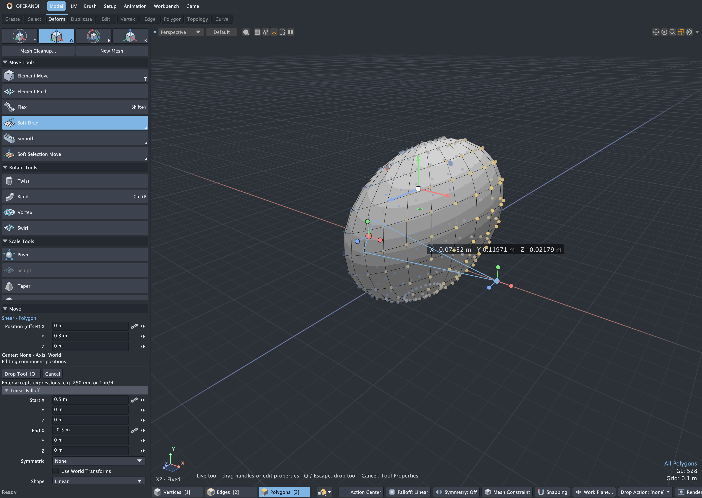

<!-- help-ids: Shear, xfrm.shear ; template: tool ; since: 0.1.0 -->
# Shear

**Shear** moves geometry with a straight falloff: one end moves fully, the other end stays, and everything between slants.

## How to use

1. Select what you want to change, or nothing to work on the whole mesh.
2. Click **Shear** in the **Move Tools** section of the **Deform** tool tab.
3. Click in the view to start, then drag the move handle.
4. Drag the falloff's ends to set where it starts and ends.
5. Press **Q**, or click **Drop Tool**, to keep the change and close the tool. **Cancel** takes it back.

## Properties

| Name | What it does | Default |
|---|---|---|
| **Position (offset)** | The move, along X, Y and Z. | 0 m |
| **Start**, **End** | Where the falloff is full (Start) and where it reaches nothing (End). | fitted to the selection |
| **Symmetric** | Mirrors the falloff about its middle. | None |
| **Use World Transforms** | Places the falloff in world space rather than the mesh's own. | Off |
| **Shape** | How the move fades from Start to End. | Linear |

## Related

- [Deform tab](index.md): what the Deform tools have in common
- [Selection modes](../selection/selection-modes.md)
- [Soft Move](soft-move.md)
