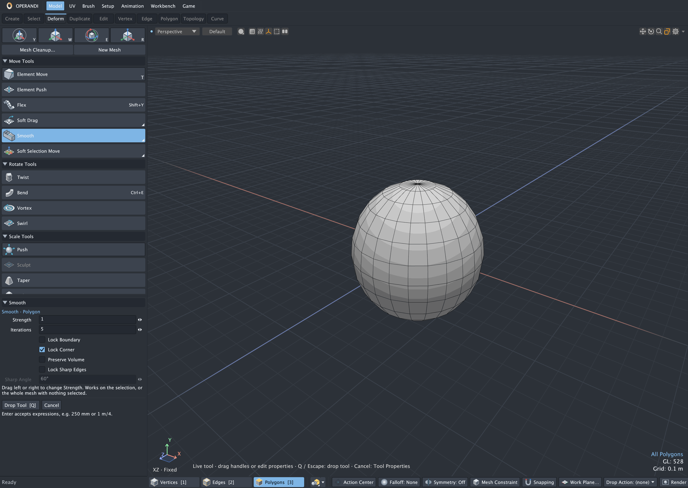

<!-- help-ids: Smooth, xfrm.smooth ; template: tool ; since: 0.1.0 -->
# Smooth

**Smooth** evens out bumps: it pulls each point toward its neighbours.

## How to use

1. Select what you want to change, or nothing to work on the whole mesh.
2. Click **Smooth** in the **Move Tools** section of the **Deform** tool tab.
3. Drag left or right in the view to change **Strength**, or type it.
4. Press **Q**, or click **Drop Tool**, to keep the change and close the tool. **Cancel** takes it back.

Smoothing shrinks a closed shape a little each pass; **Preserve Volume**
holds it at its size.

## Properties

| Name | What it does | Default |
|---|---|---|
| **Strength** | How far each pass moves the points, from 0 to 1. | 1 |
| **Iterations** | How many passes to make. | 1 |
| **Lock Boundary** | Points on open borders stay put. | Off |
| **Lock Corner** | Border points used by only one polygon stay put. | On |
| **Preserve Volume** | Keeps the shape from shrinking. | Off |
| **Lock Sharp Edges** | Keeps edges sharper than **Sharp Angle** in place. | Off, 60° |

## Related

- [Deform tab](index.md): what the Deform tools have in common
- [Selection modes](../selection/selection-modes.md)
