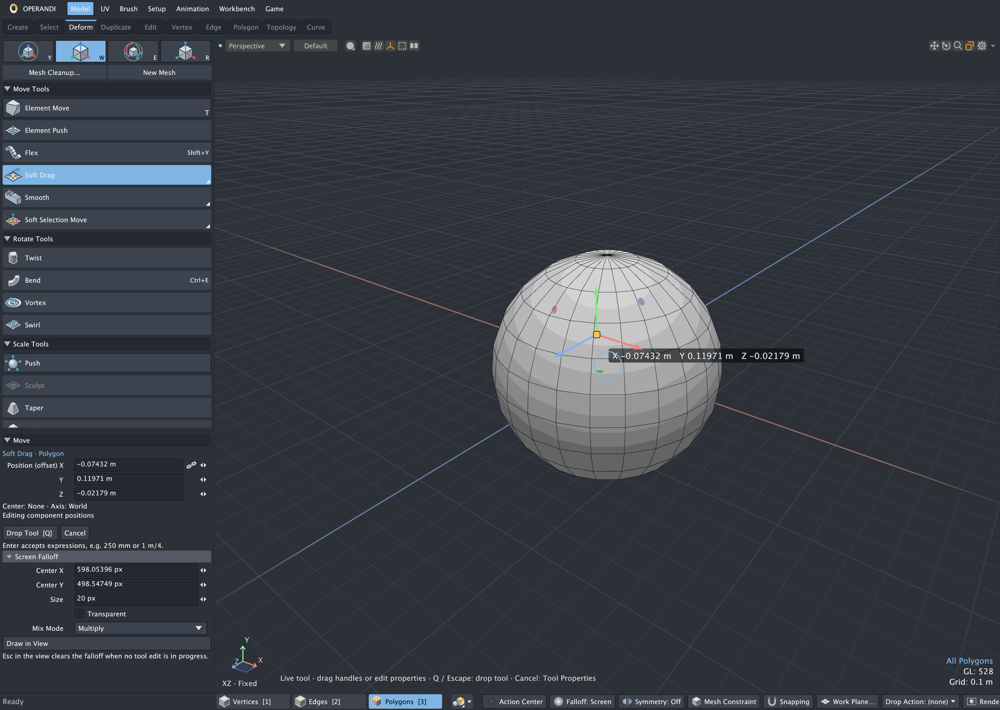

<!-- help-ids: Soft Drag, xfrm.softDrag ; template: tool ; since: 0.1.0 -->
# Soft Drag

**Soft Drag** moves what is inside a circle round the pointer, fading to nothing at the circle's edge, like pushing clay with a thumb.

## How to use

1. Select what you want to change, or nothing to work on the whole mesh.
2. Click **Soft Drag** in the **Move Tools** section of the **Deform** tool tab.
3. Drag in the view: the circle centres on each press.
4. Right-drag to change the circle's **Size**.
5. Press **Q**, or click **Drop Tool**, to keep the change and close the tool. **Cancel** takes it back.

## Properties

| Name | What it does | Default |
|---|---|---|
| **Position (offset)** | How far the last drag moved, along X, Y and Z. | 0 m |
| **Center** | Where the circle is on screen. | where you press |
| **Size** | The circle's radius on screen. | 20 px |
| **Transparent** | Reaches points behind the surface too. | Off |
| **Mix Mode** | How this falloff mixes with others. | Multiply |

**Draw in View** lets you drag a new circle.

## Related

- [Deform tab](index.md): what the Deform tools have in common
- [Selection modes](../selection/selection-modes.md)
