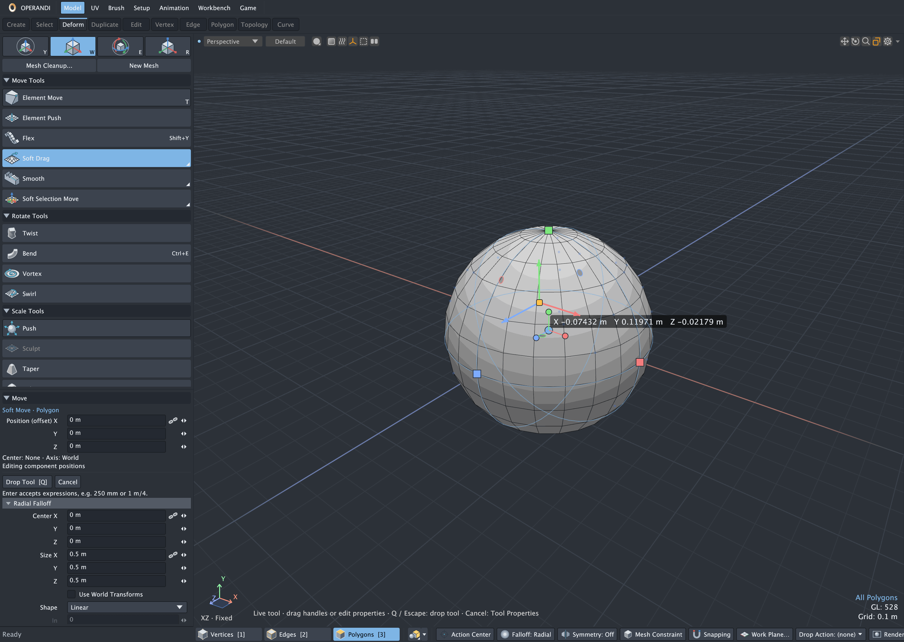

<!-- help-ids: Soft Move, xfrm.magnet ; template: tool ; since: 0.1.0 -->
# Soft Move

**Soft Move** moves geometry with a round falloff: full strength at the centre, fading to nothing at its edge.

## How to use

1. Select what you want to change, or nothing to work on the whole mesh.
2. Click **Soft Move** in the **Move Tools** section of the **Deform** tool tab.
3. Click in the view: the tool and its round falloff are placed there.
4. Drag the move handle. Drag the falloff's boxes to size it.
5. Press **Q**, or click **Drop Tool**, to keep the change and close the tool. **Cancel** takes it back.

## Properties

| Name | What it does | Default |
|---|---|---|
| **Position (offset)** | The move, along X, Y and Z. | 0 m |
| **Center** | The falloff's centre. | where you click |
| **Size** | The falloff's radius along X, Y and Z. | fitted to the selection |
| **Use World Transforms** | Places the falloff in world space rather than the mesh's own. | Off |
| **Shape** | How the move fades from the centre. | Linear |

## Related

- [Deform tab](index.md): what the Deform tools have in common
- [Selection modes](../selection/selection-modes.md)
- [Shear](shear.md)
