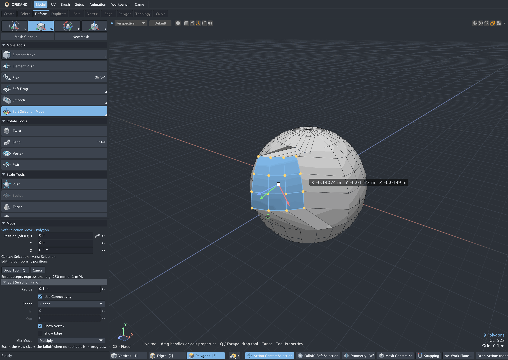

<!-- help-ids: Soft Selection Move, Soft Selection Rotate, Soft Selection Scale, Soft Selection Transform, SoftSelectionMove, SoftSelectionRotate, SoftSelectionScale, SoftSelectionTransform ; template: tool ; since: 0.1.0 -->
# Soft Selection tools

The four **Soft Selection** tools move, rotate, scale or transform the selection, and fade the effect out over **Radius** beyond it, so the selection's edge blends into the rest of the mesh.

## How to use

1. Select the points, edges or polygons to move.
2. Click **Soft Selection Move**, **Soft Selection Rotate**, **Soft
   Selection Scale** or **Soft Selection Transform** in the **Move Tools**
   section of the **Deform** tool tab.
3. Drag the handles. The pivot is the selection's centre and the axes
   follow the selection.
4. Press **Q**, or click **Drop Tool**, to keep the change and close the tool. **Cancel** takes it back.

## Falloff properties

| Name | What it does | Default |
|---|---|---|
| **Radius** | How far beyond the selection the effect fades to nothing. | 0.1 m |
| **Use Connectivity** | Only points connected to the selection are reached. | On |
| **Shape**, **In**, **Out** | How the effect fades over **Radius**. | Linear |
| **Show Vertex**, **Show Edge** | Shows the falloff's weights on points and edges. | On, Off |
| **Mix Mode** | How this falloff mixes with others. | Multiply |

The tool's own rows (**Position (offset)**, rotation or scale) are above the falloff's.

## Related

- [Deform tab](index.md): what the Deform tools have in common
- [Selection modes](../selection/selection-modes.md)
- [Flex](flex.md)
