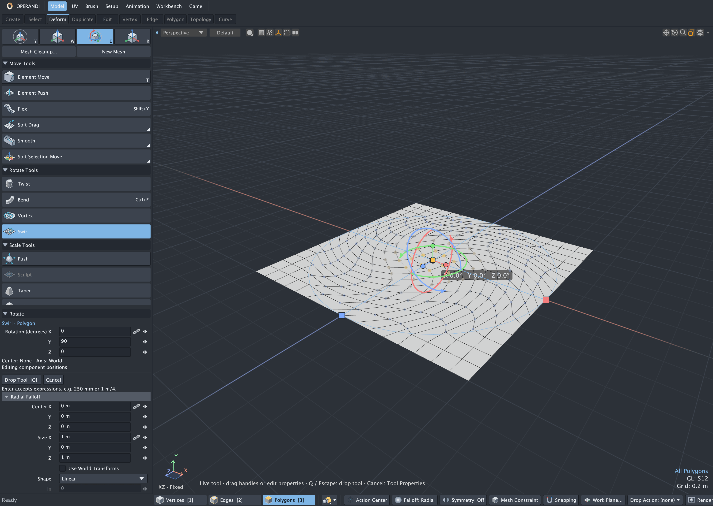

<!-- help-ids: Swirl ; template: tool ; since: 0.1.0 -->
# Swirl

**Swirl** turns points with a round falloff: the middle turns most, fading to nothing at the falloff's edge.

## How to use

1. Select what you want to change, or nothing to work on the whole mesh.
2. Click **Swirl** in the **Rotate Tools** section of the **Deform** tool tab.
3. Drag the rotate ring, or type **Rotation (degrees)**.
4. Press **Q**, or click **Drop Tool**, to keep the change and close the tool. **Cancel** takes it back.

## Properties

| Name | What it does | Default |
|---|---|---|
| **Rotation (degrees)** | The turn about X, Y and Z at full falloff strength; each point turns by its weight times this. | 0° |
| **Center**, **Size** | The falloff's centre and its radius along X, Y and Z. | fitted to the selection |
| **Use World Transforms** | Places the falloff in world space rather than the mesh's own. | Off |
| **Shape** | How the turn fades from the middle. | Linear |

## Related

- [Deform tab](index.md): what the Deform tools have in common
- [Vortex](vortex.md)
- [Twist](twist.md)
