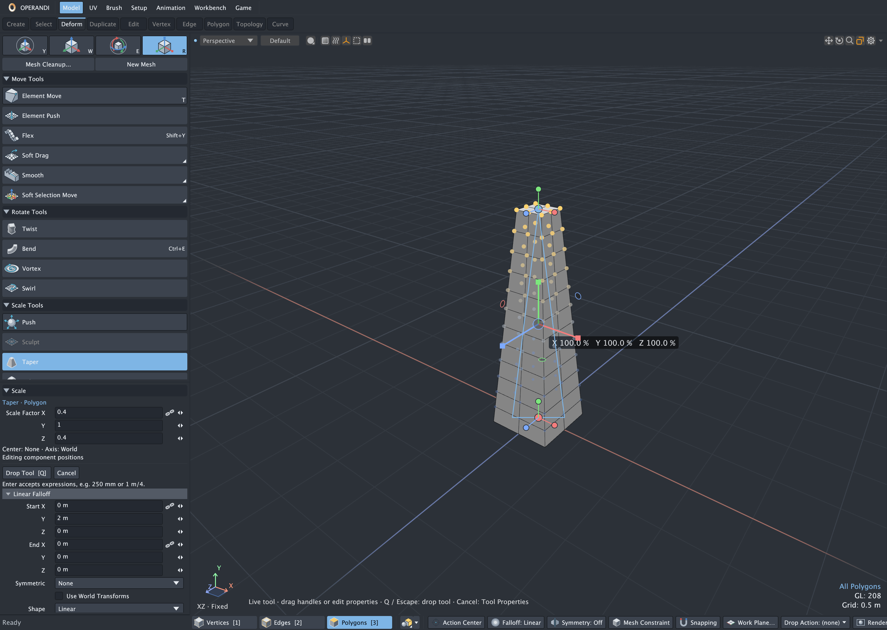

<!-- help-ids: Taper, xfrm.taper ; template: tool ; since: 0.1.0 -->
# Taper

**Taper** scales with a straight falloff: one end scales fully, the other stays as it is.

## How to use

1. Select what you want to change, or nothing to work on the whole mesh.
2. Click **Taper** in the **Scale Tools** section of the **Deform** tool tab.
3. Click in the view to place the tool (and its falloff) there.
4. Drag the scale handles, or type **Scale Factor**.
5. Drag the falloff's ends to choose which end scales.
6. Press **Q**, or click **Drop Tool**, to keep the change and close the tool. **Cancel** takes it back.

## Properties

| Name | What it does | Default |
|---|---|---|
| **Scale Factor** | The scale along X, Y and Z at full falloff strength. | 1 |
| **Start**, **End** | Where the falloff is full (Start) and where it reaches nothing (End). | fitted to the selection |
| **Symmetric** | Mirrors the falloff about its middle. | None |
| **Use World Transforms** | Places the falloff in world space rather than the mesh's own. | Off |
| **Shape** | How the effect fades from Start to End. | Linear |

## Related

- [Deform tab](index.md): what the Deform tools have in common
- [Bulge](bulge.md)
- [Flare](flare.md)
