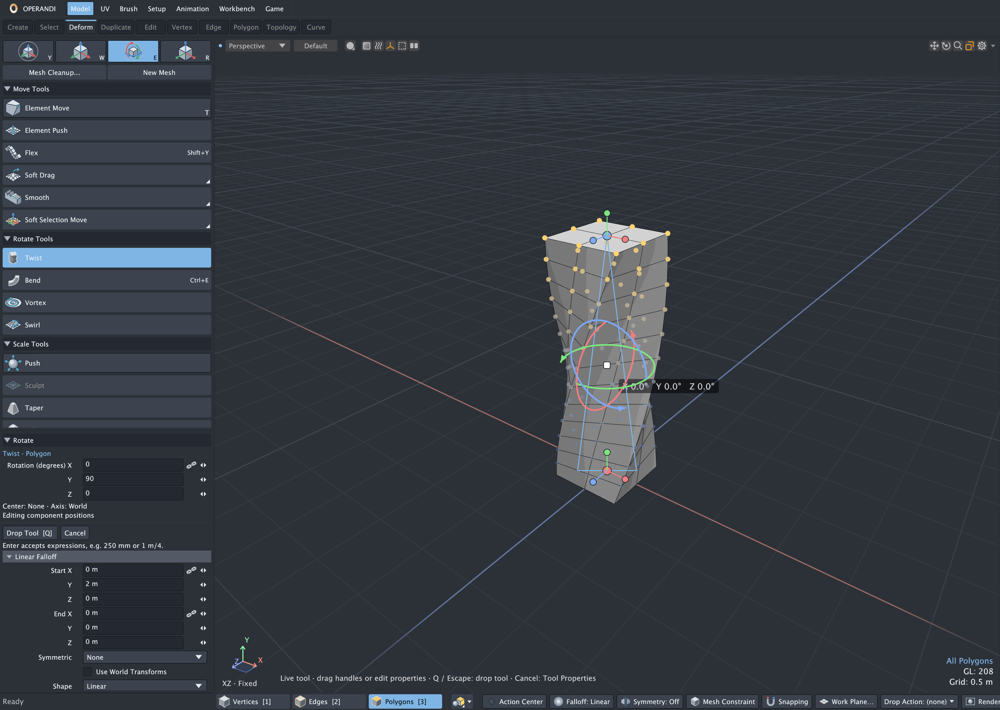

<!-- help-ids: Twist, xfrm.twist ; template: tool ; since: 0.1.0 -->
# Twist

**Twist** wrings the mesh along a line: one end turns fully, the other stays, and everything between turns part way.

## How to use

1. Select what you want to change, or nothing to work on the whole mesh.
2. Click **Twist** in the **Rotate Tools** section of the **Deform** tool tab.
3. Drag the rotate ring, or type **Rotation (degrees)**.
4. Drag the falloff's ends to set where the twist starts and ends.
5. Press **Q**, or click **Drop Tool**, to keep the change and close the tool. **Cancel** takes it back.

## Properties

| Name | What it does | Default |
|---|---|---|
| **Rotation (degrees)** | The turn about X, Y and Z at full falloff strength; each point turns by its weight times this. | 0° |
| **Start**, **End** | Where the falloff is full (Start) and where it reaches nothing (End). | fitted to the selection |
| **Symmetric** | Mirrors the falloff about its middle. | None |
| **Use World Transforms** | Places the falloff in world space rather than the mesh's own. | Off |
| **Shape** | How the effect fades from Start to End. | Linear |

## Related

- [Deform tab](index.md): what the Deform tools have in common
- [Swirl](swirl.md)
- [Vortex](vortex.md)
