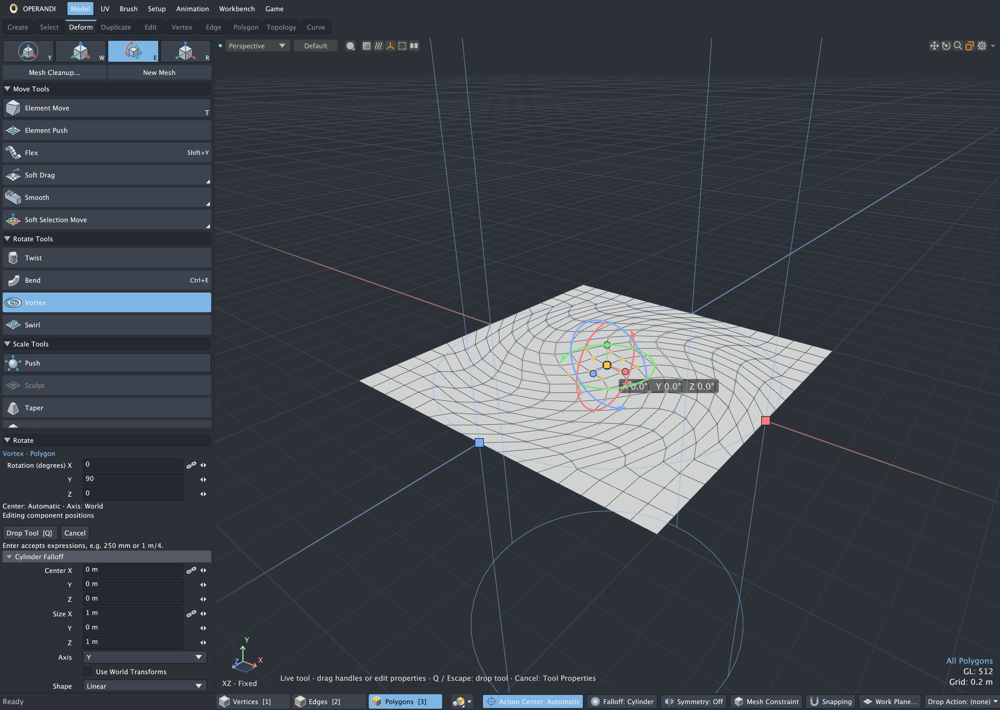

<!-- help-ids: Vortex, xfrm.vortex ; template: tool ; since: 0.1.0 -->
# Vortex

**Vortex** turns points round an axis: points on the axis turn by the full angle, fading to no turn at the falloff's radius, like water going down a drain.

## How to use

1. Select what you want to change, or nothing to work on the whole mesh.
2. Click **Vortex** in the **Rotate Tools** section of the **Deform** tool tab.
3. Click in the view to place the tool (and its falloff) there.
4. Drag the rotate ring, or type **Rotation (degrees)**.
5. Press **Q**, or click **Drop Tool**, to keep the change and close the tool. **Cancel** takes it back.

## Properties

| Name | What it does | Default |
|---|---|---|
| **Rotation (degrees)** | The turn about X, Y and Z at full falloff strength; each point turns by its weight times this. | 0° |
| **Center**, **Size** | The cylinder falloff's centre and radius. | fitted to the selection |
| **Axis** | The cylinder's axis. | Y |
| **Use World Transforms** | Places the falloff in world space rather than the mesh's own. | Off |
| **Shape** | How the turn fades out from the axis. | Linear |

## Related

- [Deform tab](index.md): what the Deform tools have in common
- [Swirl](swirl.md)
