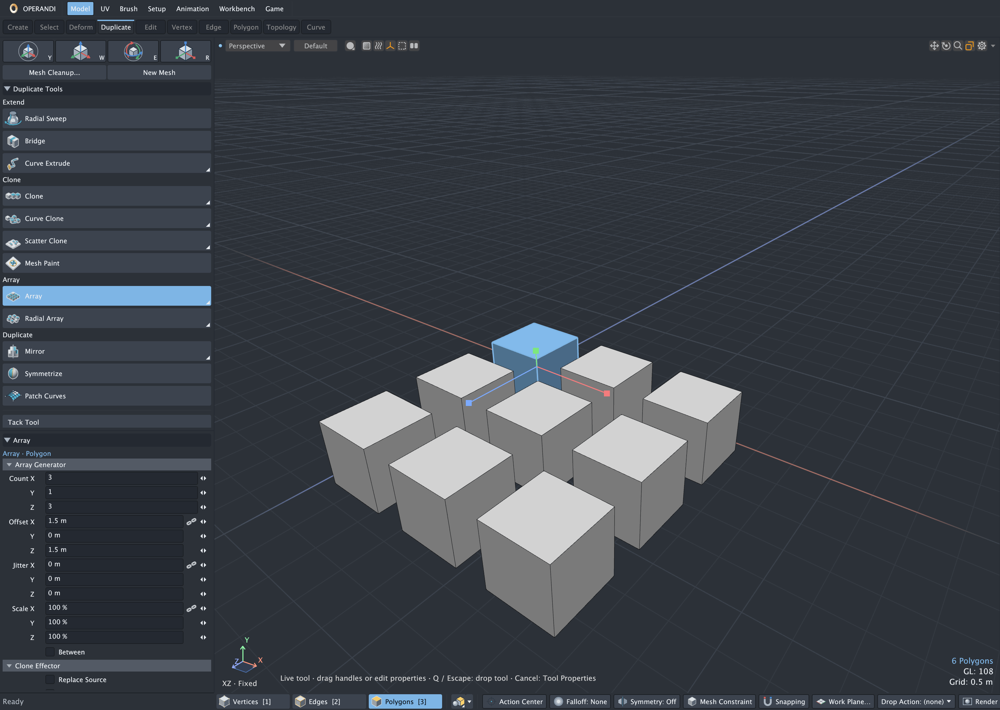

<!-- help-ids: Array, Instance Array, Instancer Array, Transform Array ; template: tool ; since: 0.1.0 -->
# Array

**Array** makes copies in a 3D grid.

## How to use

1. Select what you want to copy: polygons, or nothing for the whole mesh.
2. Click **Array** on the **Duplicate** tool tab.
3. Click in the view to start the tool, then set the copies in **Tool
   Properties** or drag the handles.
4. Press **Q**, or click **Drop Tool**, to keep the copies. **Cancel** takes
   them back.

## Properties

| Name | What it does | Default |
|---|---|---|
| **Count** | How many copies along X, Y and Z. | 2, 1, 2 |
| **Offset** | The spacing along X, Y and Z. | 1 m |
| **Between** | Makes **Offset** the distance from the first copy to the last instead. | Off |
| **Jitter** | Moves each copy by a random amount up to this. | 0 m |
| **Scale** | Scales each copy. | 100% |
| **Replace Source** | Removes the original; a copy takes its place. | Off |
| **Invert Polygons** | Turns the copies' normals the other way. | Off |
| **Merge Vertices**, **Distance** | Welds copy points that land within **Distance** of another point. | Off, 0 m |

**Alt**-click the button for the **Instance** version. The tab also has an **Instancer** and, for items, a **Transform** version; see [Duplicate tab](index.md).

## Related

- [Duplicate tab](index.md): copies, instances, Instancers and Transform versions
- [Clone](clone.md)
- [Radial Array](radial-array.md)
