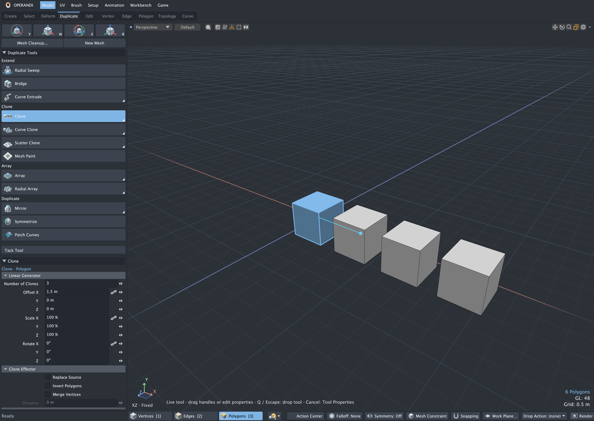

<!-- help-ids: Clone, Instance Clone, Instancer Clone ; template: tool ; since: 0.1.0 -->
# Clone

**Clone** makes copies in a line, each one offset, scaled and turned a step further than the last.

## How to use

1. Select what you want to copy: polygons, or nothing for the whole mesh.
2. Click **Clone** on the **Duplicate** tool tab.
3. Click in the view to start the tool, then set the copies in **Tool
   Properties** or drag the handles.
4. Press **Q**, or click **Drop Tool**, to keep the copies. **Cancel** takes
   them back.

## Properties

| Name | What it does | Default |
|---|---|---|
| **Number of Clones** | How many copies. | 1 |
| **Offset** | How far each copy moves from the one before. | 0 m |
| **Scale** | How much each copy is scaled from the one before. | 100% |
| **Rotate** | How far each copy turns from the one before. | 0° |
| **Replace Source** | Removes the original; a copy takes its place. | Off |
| **Invert Polygons** | Turns the copies' normals the other way. | Off |
| **Merge Vertices**, **Distance** | Welds copy points that land within **Distance** of another point. | Off, 0 m |

**Alt**-click the button for the **Instance** version. The tab also has an **Instancer** and, for items, a **Transform** version; see [Duplicate tab](index.md).

## Related

- [Duplicate tab](index.md): copies, instances, Instancers and Transform versions
- [Array](array.md)
