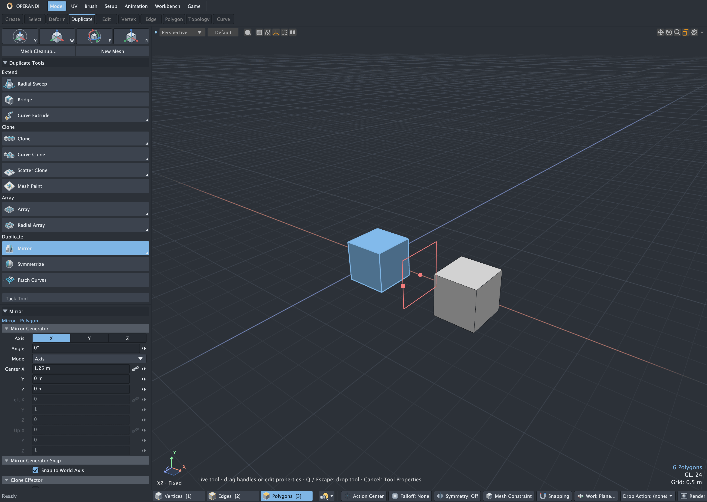

<!-- help-ids: Mirror, Instance Mirror, Instancer Mirror ; template: tool ; since: 0.1.0 -->
# Mirror

**Mirror** makes a mirror copy across a plane.

## How to use

1. Select what you want to copy: polygons, or nothing for the whole mesh.
2. Click **Mirror** on the **Duplicate** tool tab.
3. Click in the view to start the tool, then set the copies in **Tool
   Properties** or drag the handles.
   Drag the plane's handles to move or turn it.
4. Press **Q**, or click **Drop Tool**, to keep the copies. **Cancel** takes
   them back.

## Properties

| Name | What it does | Default |
|---|---|---|
| **Axis** | The axis the plane faces along. | X |
| **Angle** | Turns the plane about its centre. | 0° |
| **Mode** | **Axis** sets the plane from **Axis**; **Free Rotation** lets you type its direction. | Axis |
| **Center** | Where the plane passes. | 0 m |
| **Snap to World Axis** | Keeps the plane square to the world axes while you drag it. | On |
| **Replace Source** | Removes the original; a copy takes its place. | Off |
| **Invert Polygons** | Turns the copies' normals the other way. | Off |
| **Merge Vertices**, **Distance** | Welds copy points that land within **Distance** of another point. | Off, 0 m |

**Alt**-click the button for the **Instance** version. The tab also has an **Instancer** and, for items, a **Transform** version; see [Duplicate tab](index.md).

## Related

- [Duplicate tab](index.md): copies, instances, Instancers and Transform versions
- [Symmetrize](symmetrize.md)
