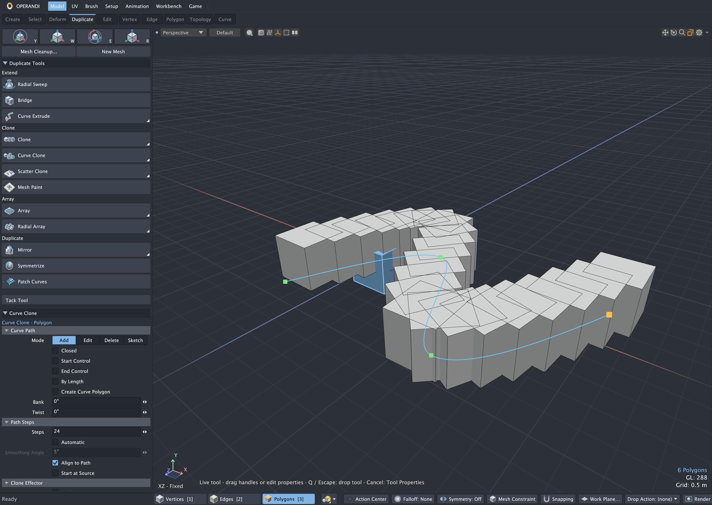

<!-- help-ids: Curve Extrude, Bezier Extrude, B-Spline Extrude, Pen Extrude, Curve Clone, Curve Instance, Curve Instancer, Curve Transform, Bezier Clone, Bezier Instance, Bezier Instancer, Bezier Transform, B-Spline Clone, B-Spline Instance, B-Spline Instancer, B-Spline Transform, Pen Clone, Pen Instance, Pen Instancer, Transform Pen ; template: tool ; since: 0.1.0 -->
# Path tools

The path tools work along a path you click out in the view: a smooth **Curve**, a **Bezier** path with handles, a **B-Spline**, or a straight-line **Pen** path. **Extrude** stretches the selected polygons along the path; **Clone** puts copies along it.

## How to use

1. Select the polygons to extrude or copy.
2. Click the tool on the **Duplicate** tool tab: **Curve Extrude** (Control-click:
   **Bezier Extrude**) or **Curve Clone**, or one of the other path buttons.
3. Click in the view to place the path's points, as with the
   [Curve](../modeling/curve.md), [Bezier](../modeling/bezier.md),
   [B-Spline](../modeling/b-spline.md) and [Pen](../modeling/pen.md) tools.
4. Press **Q**, or click **Drop Tool**, to keep the result.

## The tools

| Path | Extrude | Clone | Instance | Instancer | Transform |
|---|---|---|---|---|---|
| Curve | Curve Extrude | Curve Clone | Curve Instance | Curve Instancer | Curve Transform |
| Bezier | Bezier Extrude | Bezier Clone | Bezier Instance | Bezier Instancer | Bezier Transform |
| B-Spline | B-Spline Extrude | B-Spline Clone | B-Spline Instance | B-Spline Instancer | B-Spline Transform |
| Pen | Pen Extrude (one section per point) | Pen Clone (one copy per point, turned to follow the path) | Pen Instance | Pen Instancer | Transform Pen |

**Alt**-click **Curve Clone** for **Curve Instance**.

## Related

- [Duplicate tab](index.md): copies, instances, Instancers and Transform versions
- [Clone](clone.md)
