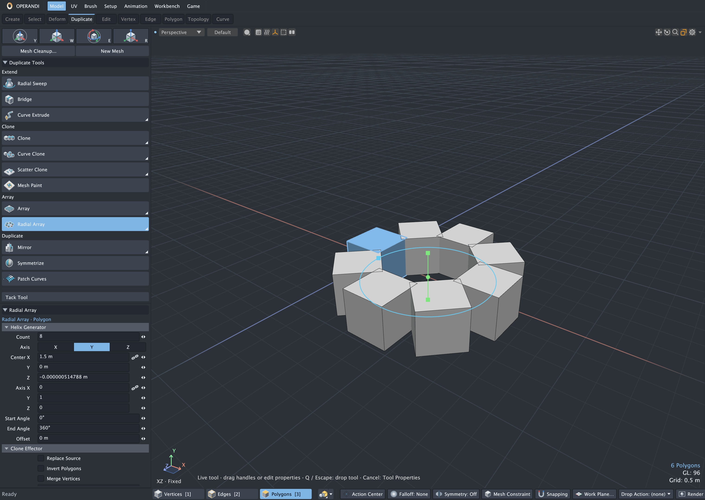

<!-- help-ids: Radial Array, Instance Radial Array, Instancer Radial Array, Transform Radial Array ; template: tool ; since: 0.1.0 -->
# Radial Array

**Radial Array** makes copies round an axis, like spokes of a wheel or teeth of a gear.

## How to use

1. Select what you want to copy: polygons, or nothing for the whole mesh.
2. Click **Radial Array** on the **Duplicate** tool tab.
3. Click in the view to start the tool, then set the copies in **Tool
   Properties** or drag the handles.
4. Press **Q**, or click **Drop Tool**, to keep the copies. **Cancel** takes
   them back.

## Properties

| Name | What it does | Default |
|---|---|---|
| **Count** | How many copies round the circle. | 8 |
| **Axis** | The axis the copies go round. | Y |
| **Center** | Where the axis passes. | 0 m |
| **Start Angle**, **End Angle** | How far round the circle the copies reach. | 0°, 360° |
| **Offset** | Moves the copies along the axis, step by step, for a helix. | 0 m |
| **Replace Source** | Removes the original; a copy takes its place. | Off |
| **Invert Polygons** | Turns the copies' normals the other way. | Off |
| **Merge Vertices**, **Distance** | Welds copy points that land within **Distance** of another point. | Off, 0 m |

**Alt**-click the button for the **Instance** version. The tab also has an **Instancer** and, for items, a **Transform** version; see [Duplicate tab](index.md).

## Related

- [Duplicate tab](index.md): copies, instances, Instancers and Transform versions
- [Radial Sweep](radial-sweep.md)
