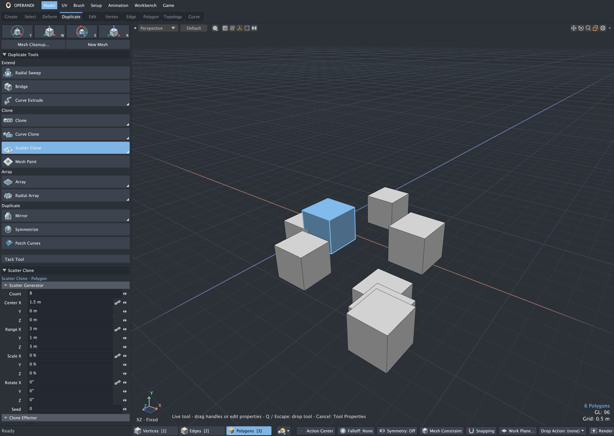

<!-- help-ids: Scatter Clone, Instance Scatter, Instancer Scatter, Transform Scatter ; template: tool ; since: 0.1.0 -->
# Scatter Clone

**Scatter Clone** scatters copies at random inside a box, each with its own random size and turn.

## How to use

1. Select what you want to copy: polygons, or nothing for the whole mesh.
2. Click **Scatter Clone** on the **Duplicate** tool tab.
3. Click in the view to start the tool, then set the copies in **Tool
   Properties** or drag the handles.
4. Press **Q**, or click **Drop Tool**, to keep the copies. **Cancel** takes
   them back.

## Properties

| Name | What it does | Default |
|---|---|---|
| **Count** | How many copies. | 8 |
| **Center** | The middle of the box. | 0 m |
| **Range** | The box's size along X, Y and Z. | 1 m |
| **Scale** | How far each copy's size may vary at random. | 0% |
| **Rotate** | How far each copy may turn at random. | 0° |
| **Seed** | Picks the random pattern; the same seed gives the same scatter. | 0 |
| **Replace Source** | Removes the original; a copy takes its place. | Off |
| **Invert Polygons** | Turns the copies' normals the other way. | Off |
| **Merge Vertices**, **Distance** | Welds copy points that land within **Distance** of another point. | Off, 0 m |

**Alt**-click the button for the **Instance** version. The tab also has an **Instancer** and, for items, a **Transform** version; see [Duplicate tab](index.md).

## Related

- [Duplicate tab](index.md): copies, instances, Instancers and Transform versions
- [Mesh Paint](../modeling/mesh-paint.md)
