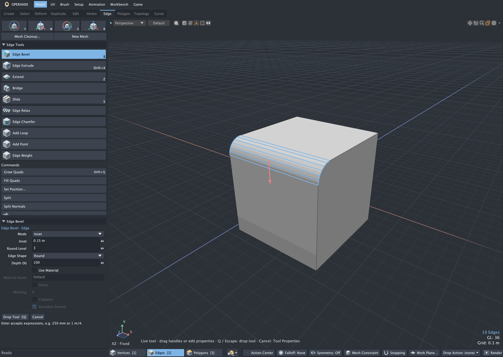
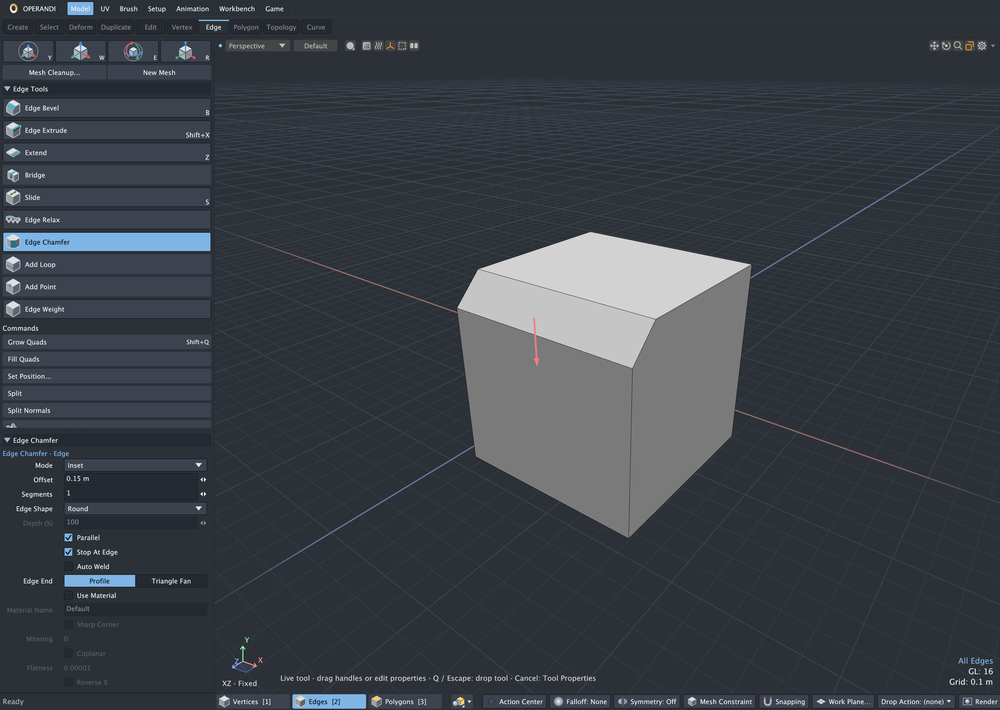

<!-- help-ids: Edge Bevel, edge.bevel, Edge Chamfer, edge.chamfer ; template: tool ; since: 0.1.0 -->
# Edge Bevel and Edge Chamfer

**Edge Bevel** rounds the selected edges off with new rows of polygons; **Edge Chamfer** cuts them flat.

## How to use

1. Press **2** for Edges and select the edges.
2. Press **B** (Edge Bevel), or click **Edge Bevel** or **Edge Chamfer**.
3. Drag in the view, or type the **Inset**.
4. Press **Q**, or click **Drop Tool**, to keep the result. **Cancel** takes it back.

## Properties

| Name | What it does | Default |
|---|---|---|
| **Mode** | **Inset** measures along the sides; **Width** measures across the corner, so the sides move further on sharp corners. | Inset |
| **Inset** (or **Width**) | How far the bevel reaches from the edge. | 0 m |
| **Round Level** | How many rows round the bevel; 0 is a flat chamfer. | 0 |
| **Edge Shape** | **Round**, or **Square** and **Sharp** (two flat strips meeting at the original edge). | Round |
| **Depth** | 100% is the full round profile; lower values flatten it toward a chamfer. | 100% |
| **Parallel** | Keeps each new edge the inset away from the original edge. | — |
| **Stop At Edge** | Side points stop at the far end of their edge instead of running past it. | — |
| **Auto Weld** | Merges new points that land on another point. | — |
| **Edge End** | **Profile**: an inner end keeps its point. **Triangle Fan**: it slides along the edge beyond and closes with triangles. | Profile |
| **Use Material**, **Material Name** | Gives the new polygons a material. | Off |

The greyed rows (**Sharp Corner**, **Mitering**, **Coplanar** and the others below them) aren't available yet.

## Related

- [Edge tab](index.md)
- [Selection: loops and rings](../selection/loops.md)
- [Bevel (polygons)](../modeling/polygon-bevel.md)
- [Vertex Bevel](../vertex/vertex-bevel.md)
