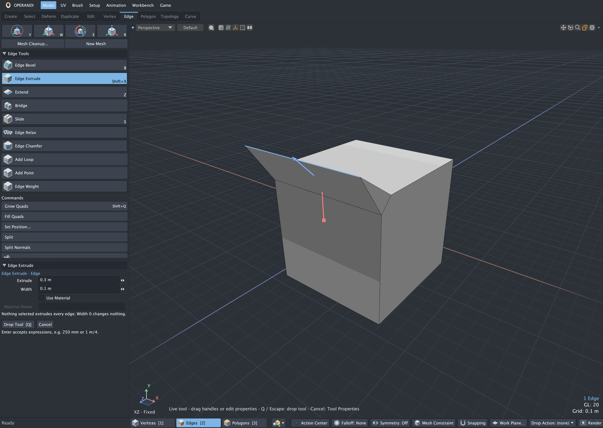

<!-- help-ids: Edge Extrude ; template: tool ; since: 0.1.0 -->
# Edge Extrude

**Edge Extrude** pulls the selected edges out into new polygons, like folding out a flap.

## How to use

1. Press **2** for Edges and select the edges.
2. Press **Shift+X**, or click **Edge Extrude**.
3. Drag in the view, or type **Extrude** and **Width**.
4. Press **Q**, or click **Drop Tool**, to keep the result. **Cancel** takes it back.

## Properties

| Name | What it does | Default |
|---|---|---|
| **Extrude** | How far the new edge moves out. | 0 m |
| **Width** | How far the new polygons spread sideways. | 0 m |

## Related

- [Edge tab](index.md)
- [Selection: loops and rings](../selection/loops.md)
- [Extend](extend.md)
