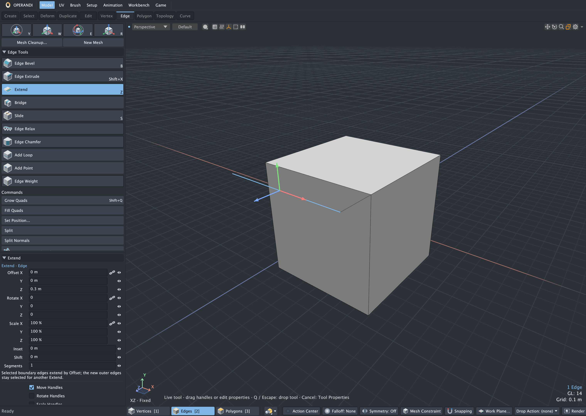

<!-- help-ids: Extend, edge.extend ; template: tool ; since: 0.1.0 -->
# Extend

**Extend** adds a new row of polygons at the selected border edges, and moves, turns or scales the new edges with its handles.

## How to use

1. Press **2** for Edges and select the edges.
2. Press **Z**, or click **Extend**.
3. Drag the move, rotate or scale handles, or type the offsets.
4. Press **Q**, or click **Drop Tool**, to keep the result. **Cancel** takes it back.

## Properties

Extend's rows are the offset (X, Y, Z), the rotation and scale of the new edges, **Segments**, **Inset**, **Shift**, and which handles show. They can also be set from scripts with `tool.attr edge.extend`.

## Related

- [Edge tab](index.md)
- [Selection: loops and rings](../selection/loops.md)
- [Edge Extrude](edge-extrude.md)
