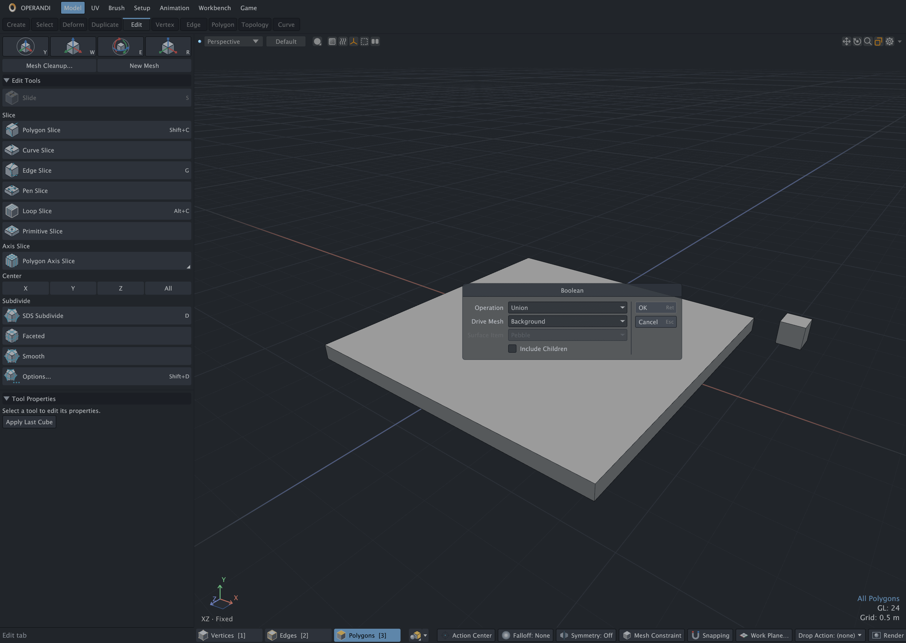

<!-- help-ids: Boolean, poly.boolean, Solid Drill, poly.solidDrill, Axis Drill, poly.drill, curve.boolean ; template: tool ; since: 0.1.0 -->
# Booleans and drills

**Boolean** combines the active mesh with other meshes; the drills cut the shape of one mesh into another.

## The commands

| Button | What it does |
|---|---|
| **Boolean...** | **Union**, **Intersect**, **Subtract** or **Add** the active mesh with the driver meshes. |
| **Solid Drill...** | Cuts the active mesh's polygons where a closed driver passes through them. |
| **Axis Drill...** | Cuts the active mesh's polygons with the driver's outline pushed straight along an axis. |
| **Curve Boolean...** | Slices, unites, intersects or subtracts the selected closed curves with the other curves. |

## How to use

1. Select the mesh to change in the **Items list**.
2. Keep the other mesh (the *driver*) visible but not selected: it is the
   background mesh.
3. Click the command on the **Edit** tool tab, set the options and click
   **OK**.

## Boolean options

| Name | What it does | Default |
|---|---|---|
| **Operation** | **Union**, **Intersect**, **Subtract** or **Add**. | Union |
| **Drive Mesh** | Which meshes drive the boolean: the **Background** meshes, or one item (**Surface Item**). | Background |
| **Include Children** | Also uses the driver's child items. | Off |

## Related

- [Edit tab](index.md)
