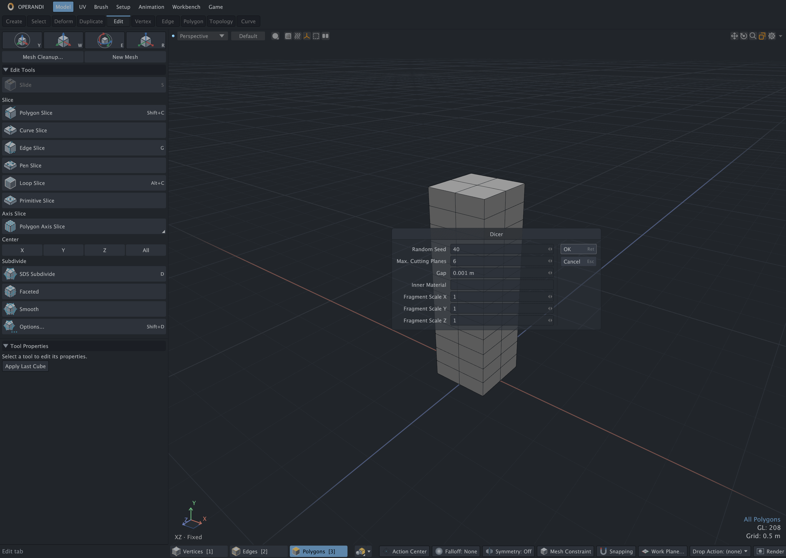

<!-- help-ids: operandi.dicer ; template: tool ; since: 0.1.0 -->
# Dicer

**Dicer** smashes the active mesh into closed chunks, cut by random planes, ready to fall apart or to shade as broken pieces.

## How to use

1. Select the mesh to break.
2. Click **Dicer…** in the **Edit Tools** section of the **Edit** tool tab.
3. Set the options and click **OK**.

## Options

| Name | What it does | Default |
|---|---|---|
| **Random Seed** | Picks the random planes; the same seed cuts the same way. | 40 |
| **Max. Cutting Planes** | How many planes cut the mesh at most. | 6 |
| **Gap** | Space left between the chunks. | 0.001 m |
| **Inner Material** | The material for the new cut faces. | empty |
| **Fragment Scale X**, **Y**, **Z** | Stretches the chunks along each axis. | 1 |

## Related

- [Edit tab](index.md)
