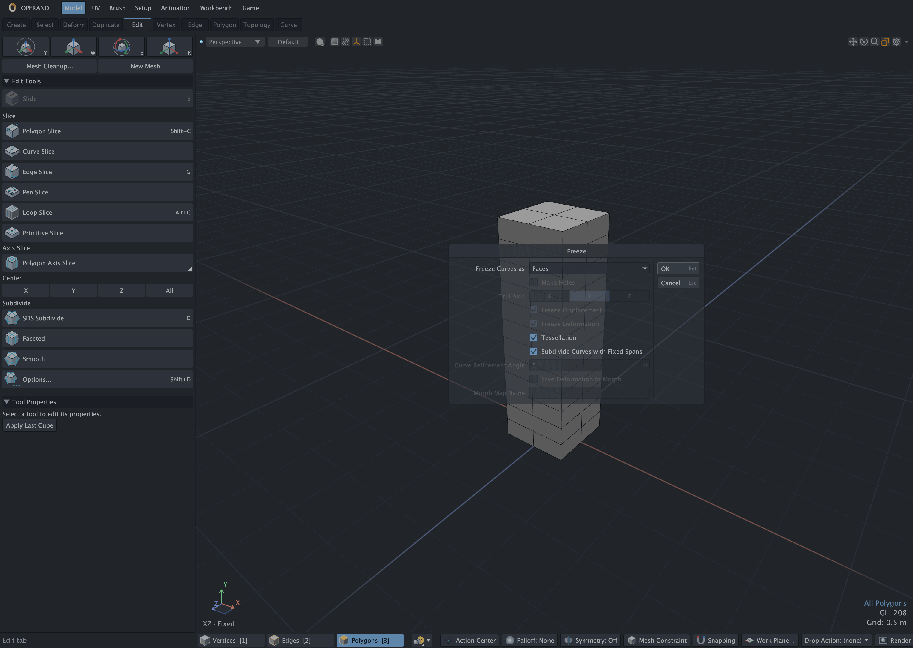

<!-- help-ids: poly.freeze, Freeze ; template: tool ; since: 0.1.0 -->
# Freeze

**Freeze** turns curves and subdivision-surface polygons into plain polygons, so they can be edited like any other.

## How to use

1. Select the items or polygons to freeze, or nothing for the whole mesh.
2. Click **Freeze...** in the **Subdivide** section of the **Edit** tool
   tab.
3. Set the options and click **OK**.

## Options

| Name | What it does | Default |
|---|---|---|
| **Freeze Curves as** | What curves become: **Faces**, polylines or two-point polygons. | Faces |
| **Tessellation** | Freezes subdivision surfaces into their smoothed polygons. | On |
| **Subdivide Curves with Fixed Spans** | Splits each curve span into the same number of segments. | On |

The greyed rows apply to other kinds of item.

## Related

- [Edit tab](index.md)
- [Subdivide](subdivide.md)
