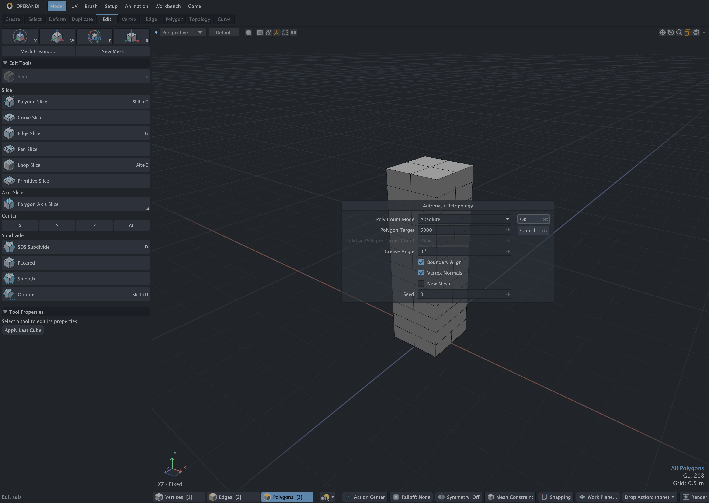
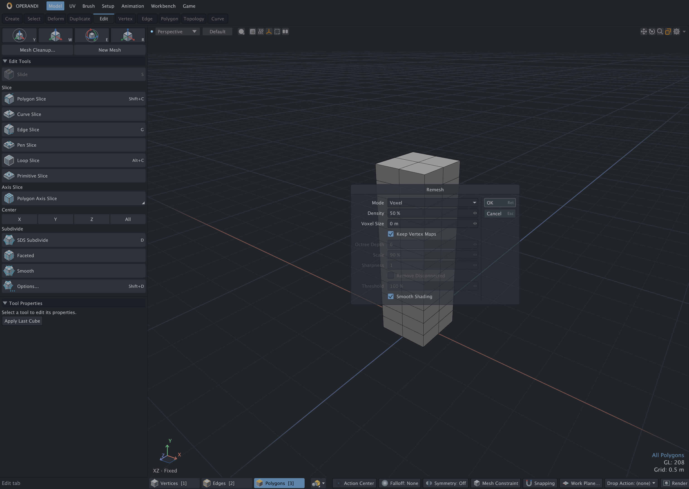

<!-- help-ids: Retopo Sketch, Automatic Retopology, mesh.retopo, Remesh, sculpt.remesh, operandi.remesh, Retopo Edge Lock, Retopo Edge Flow ; template: tool ; since: 0.1.0 -->
# Retopology and Remesh

These tools rebuild a mesh's polygons: by hand over a background model, or automatically as even quads or voxels.

## The tools

| Tool | What it does |
|---|---|
| [**Topology Pen**](../modeling/topology-pen.md) | Draw and reshape new polygons by hand over a background mesh. |
| **Retopo Sketch** | Drag across a background mesh to draw a guide curve on it (a point every 3 cm). |
| **Automatic Retopology...** | Rebuilds the whole active mesh as even quads that follow its shape. |
| **Remesh...** | Rebuilds the whole active mesh: **Voxel**, or **Blocks**, **Smooth** and **Sharp**. |
| **Retopo Edge Lock**, **Retopo Edge Flow** | Mark the selected guide curves for Automatic Retopology: keep an edge along them (Lock), or steer the edge flow (Flow). |

## Automatic Retopology options

| Name | What it does | Default |
|---|---|---|
| **Poly Count Mode** | **Absolute** (a polygon target) or relative to the mesh. | Absolute |
| **Polygon Target** | How many polygons to aim for. | 5000 |
| **Crease Angle** | Keeps edges sharper than this. | 0° |
| **Boundary Align** | Lines edges up with open borders. | On |
| **Vertex Normals** | Follows the mesh's vertex normals. | On |
| **New Mesh** | Puts the result in a new item instead of replacing the mesh. | Off |
| **Seed** | Picks the random start. | 0 |

## Remesh options

| Name | What it does | Default |
|---|---|---|
| **Mode** | **Voxel**, **Blocks**, **Smooth** or **Sharp**. | Voxel |
| **Density**, **Voxel Size** | How fine the new mesh is: a density, or an exact voxel size. | 50%, 0 m |
| **Keep Vertex Maps** | Carries vertex maps over to the new mesh. | On |
| **Smooth Shading** | Shades the result smoothly. | On |

The greyed rows (**Octree Depth**, **Scale**, **Sharpness**, **Remove Disconnected**, **Threshold**) apply to the **Blocks**, **Smooth** and **Sharp** modes.

## Related

- [Edit tab](index.md)
- [Topology Pen](../modeling/topology-pen.md)
