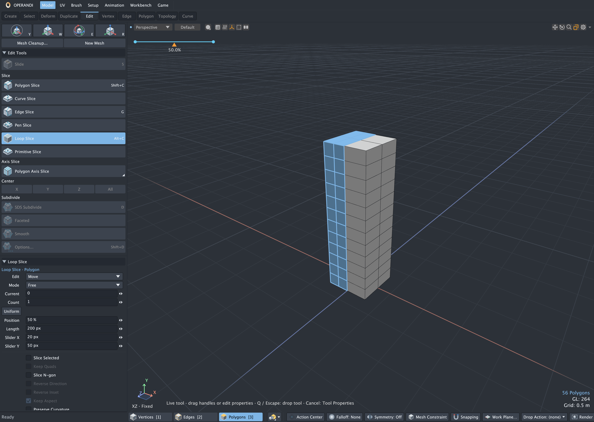

<!-- help-ids: Polygon Slice, Curve Slice, Edge Slice, Pen Slice, Loop Slice, Primitive Slice, Polygon Axis Slice ; template: tool ; since: 0.1.0 -->
# Slice tools

The slice tools cut new edges into a mesh: along a line, a curve, a loop round the mesh, or the outline of a shape.

## The tools

| Tool | Key | What it does |
|---|---|---|
| **Polygon Slice** | **Shift+C** | Cuts the selected polygons along a line you drag across them. |
| **Polygon Axis Slice** |  | Cuts the polygons along a plane square to an axis. |
| **Curve Slice** |  | Cuts along a curve you click out. |
| **Edge Slice** | **G** | Cuts from edge to edge as you click them. |
| **Pen Slice** |  | Cuts along a straight-line path you click out. |
| **Loop Slice** | **Alt+C** | Adds loops all the way round a ring of polygons. |
| **Primitive Slice** |  | Cuts along the outline of a shape (a rectangle, a circle) you draw. |

## Loop Slice

1. Select polygons (or edges) in the ring you want to cut across.
2. Press **Alt+C**, or click **Loop Slice**.
3. Set **Count** for how many loops, and drag in the view (or set
   **Position**) to place them.
4. Press **Q** to keep them.

### Loop Slice properties

| Name | What it does | Default |
|---|---|---|
| **Edit** | What a drag does to the loops: **Move** them, or other edits. | Move |
| **Mode** | How the loops are placed: **Free**, or evenly. | Free |
| **Count** | How many loops. | 1 |
| **Current** | Which loop the **Position** field edits. | 0 |
| **Uniform** | Spaces the loops evenly. |  |
| **Position** | Where the current loop crosses its polygons. | 50% |
| **Slice Selected** | Cuts only the selected polygons, not the whole ring. | Off |
| **Slice N-gon** | Also cuts through polygons with more than four sides. | Off |
| **Preserve Curvature** | Bends new points out to follow the surface's curve. | Off |

## Related

- [Edit tab](index.md)
- [Selection: loops and rings](../selection/loops.md)
