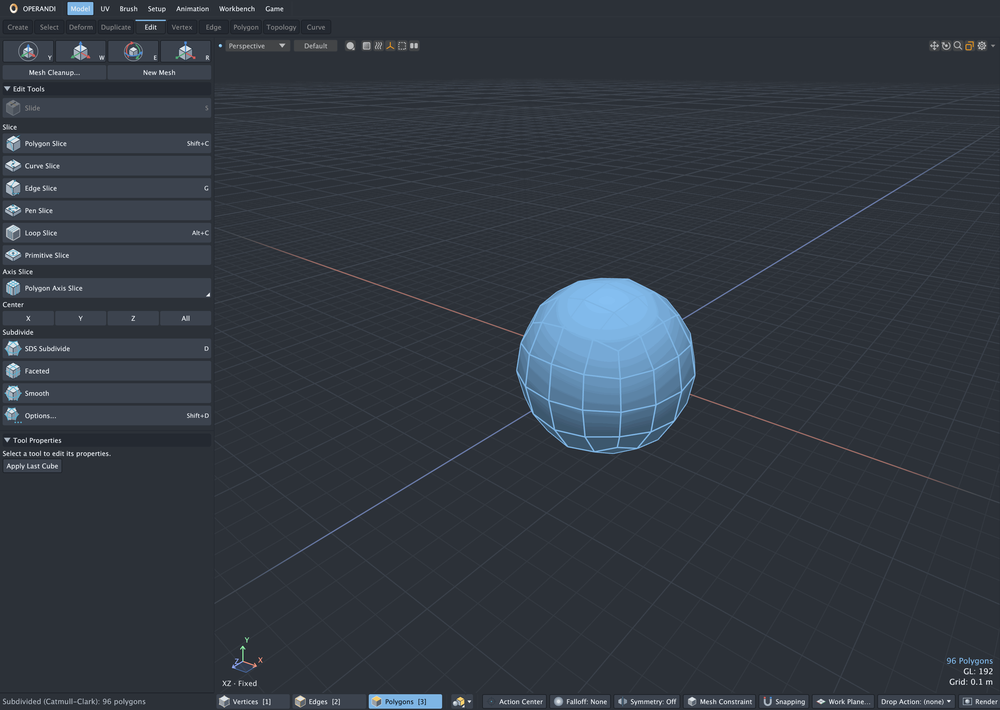
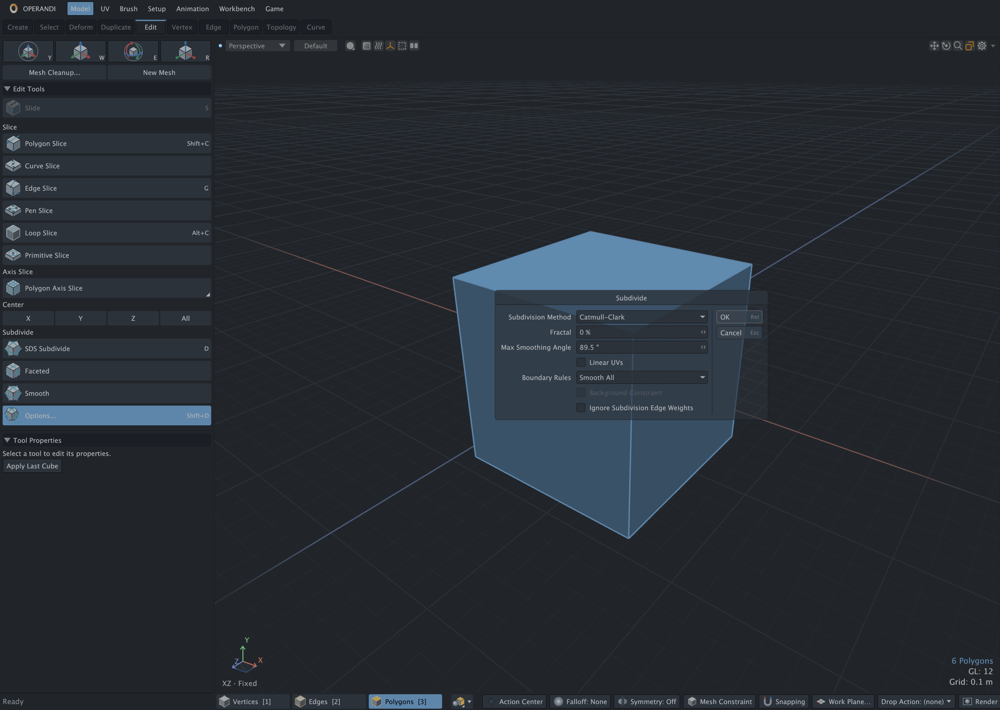

<!-- help-ids: SDS Subdivide, SDS Subdivide 2X, Faceted Subdivide, Smooth Subdivide, Subdivide Options, UnSubdivide, poly.subdivide, poly.unsubdiv ; template: tool ; since: 0.1.0 -->
# Subdivide

**Subdivide** splits the selected polygons into smaller ones, either keeping the shape or smoothing it.

## The commands

| Button | Key | What it does |
|---|---|---|
| **SDS Subdivide** | **D** | Splits each polygon and smooths the result (Catmull-Clark). **Alt**-click to do it twice. |
| **Faceted** |  | Splits the polygons without changing the shape. |
| **Smooth** |  | Splits and rounds the polygons, keeping sharp edges. |
| **Options...** | **Shift+D** | Opens the full Subdivide dialog. |
| **UnSubdivide...** |  | Undoes a Catmull-Clark subdivision by merging quads back. |

With nothing selected, they work on the whole mesh. In Edge mode **D** is **Edge Subdivide** instead.

## Subdivide options

| Name | What it does | Default |
|---|---|---|
| **Subdivision Method** | **Catmull-Clark**, faceted or smooth splitting. | Catmull-Clark |
| **Fractal** | Moves the new points by a random amount, for a rough surface. | 0% |
| **Max Smoothing Angle** | Edges sharper than this stay sharp. | 89.5° |
| **Linear UVs** | Splits the UVs straight instead of smoothing them. | Off |
| **Boundary Rules** | How open borders are smoothed. | Smooth All |
| **Ignore Subdivision Edge Weights** | Smooths creased edges too. | Off |

## Related

- [Edit tab](index.md)
- [Freeze](freeze.md)
