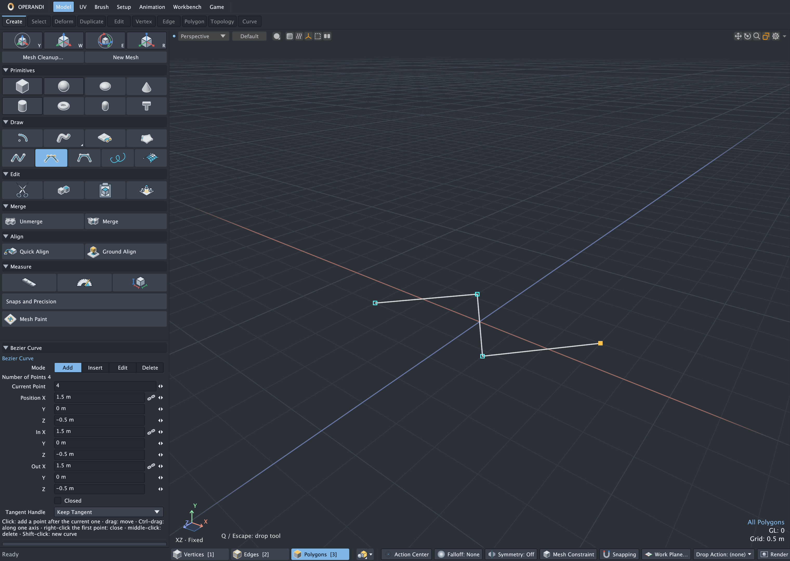

<!-- help-ids: Bezier Curve, prim.bezier ; template: tool ; since: 0.1.0 -->
# Bezier

**Bezier** draws a curve whose shape at each point you set with two handles, **In** and **Out**.

## How to use

1. Make sure the mesh you want to work on is selected in the **Items list**.
2. Click **Bezier** in the **Draw** section of the **Create** tool tab.
3. In the **3D view**:
   
   - Click to add a point after the current one.
   - Drag a point to move it; **Control**+drag keeps it on one axis.
   - Right-click the first point to close the curve.
   - Middle-click a point to delete it.
   - **Shift**-click to start a new curve.
4. Drag a point's handles to change how the curve bends through it.
5. Press **Q**, or click **Drop**, to keep it and close the tool.

**Mode** has an extra choice here, **Insert**, which adds a point on the
curve between two others.

## Properties

| Name | What it does | Default |
|---|---|---|
| **Mode** | What a click does: **Add**, **Insert**, **Edit** or **Delete** points. | Add |
| **Current Point** | Which point the fields edit. | the last one |
| **Position** | The current point's place (X, Y, Z). | where you clicked |
| **In**, **Out** | Where the current point's two handles are. | on the point |
| **Closed** | Joins the last point back to the first. | Off |
| **Tangent Handle** | What dragging one handle does to the other: **Keep Tangent** keeps them in line, **Uniform Length** also keeps them the same length, **Break** moves one alone. | Keep Tangent |

## Related

- [Interface](../interface/window.md): the **Toolbox** and **Tool Properties**
- [Curve](curve.md), [B-Spline](b-spline.md)
