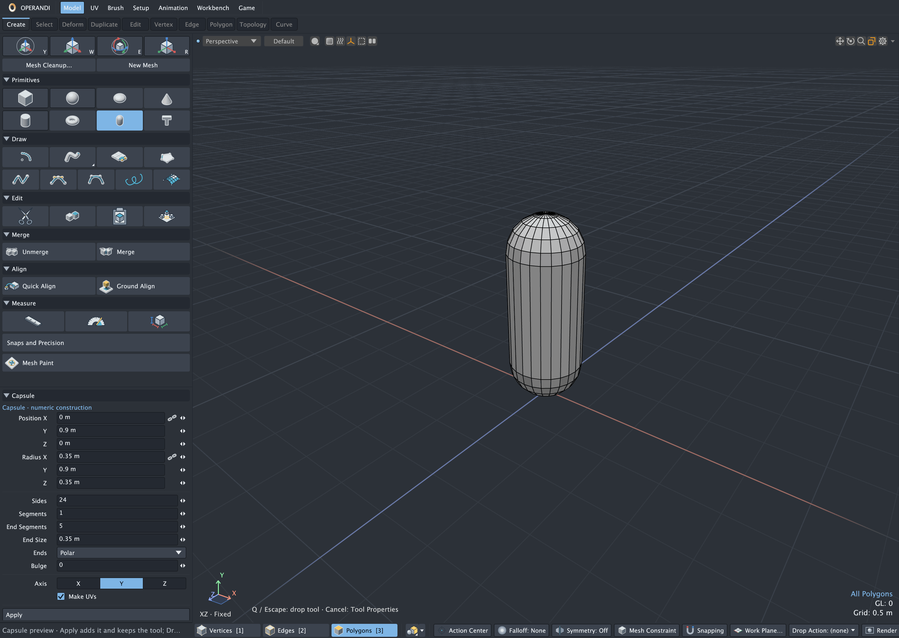

<!-- help-ids: Capsule, prim.capsule, Capsule Unit, Capsule New Unit ; template: tool ; since: 0.1.0 -->
# Capsule

**Capsule** adds a pill shape: a straight body with a rounded end at each side.

## How to use

1. Make sure the mesh you want to add to is selected in the **Items list**.
2. Click **Capsule** in the **Primitives** section of the **Create** tool tab.
3. Drag in the **3D view**. The drag draws the capsule's base flat on the
   **Work Plane**, centred on where you press.
4. Press on the dot in the middle of the flat base and drag up to give it its height.
5. Fine-tune it: drag its handles, or type values in **Tool Properties**.
6. Press **Q** (or **Esc**), or click **Capsule** again, to drop the tool
   and keep the capsule.

To draw it the same size in every direction instead, hold **Control** before
you start the drag: the press is the centre and the pointer sets the
size.

## Without a drag

- **Shift**-click **Capsule** adds a 1 m capsule as a new mesh item at
  the scene's origin.
- **Control**-click **Capsule** adds a 1 m capsule to the selected mesh, at
  its origin.

## Properties

| Name | What it does | Default |
|---|---|---|
| **Position** | Where the centre is (X, Y, Z). | 0 m |
| **Radius** | Half the size along X, Y and Z; along the **Axis** it is half the length. | 0.25, 0.75, 0.25 m |
| **Sides** | How many polygons go round the axis. | 24 |
| **Segments** | How many rows of polygons the straight body has. | 1 |
| **End Segments** | How many rows each rounded end has. | 5 |
| **End Size** | How long each rounded end is. | 0.25 m |
| **Ends** | **Polar**: each end closes in a point. **Quad Grid**: each end is filled with four-sided polygons only. | Polar |
| **Bulge** | Swells the body. | 0 |
| **Axis** | The axis from end to end. | Y |
| **Make UVs** | Gives the shape a UV layout in the **Texture** UV map, for textures. | On |

- **Apply** adds the capsule to the mesh and keeps the tool, so you can
  make another.
- **Drop** adds it and closes the tool.
- **Cancel** throws the preview away.
- **Reset** puts every value back to its starting value.

## Tips

- Right-drag in the **3D view**, away from the handles: left and right change **Sides**, up and down change **Segments**.

## In the Mesh Stack

You can also add a Capsule as a step of a mesh's **Mesh Stack**: choose
**Capsule** under **Create > Primitives** in the stack's **Add Operator**
list. It has the same properties as the tool, and the tool and the stack
step build exactly the same capsule from the same values, so you can
change it later without rebuilding the mesh. Scripts
add it with `meshop.create type:prim.capsule.item`.

With the step selected in the stack and no tool on, its handles show in the
**3D view**. Drag an arrow to move it along that axis, a plane square or the centre dot to move it across a plane, and a size square at its edge to resize it. Each drag is one undo step. A right-drag anywhere else changes its counts, as with the tool: left and right for **Sides**, up and down for **Segments**.

## Related

- [Primitives](../interface/window.md): the **Toolbox** on the **Create** tab
- [Interface](../interface/window.md): the **Work Plane** and **Tool Properties**
- [Sphere](sphere.md), [Cylinder](cylinder.md)
