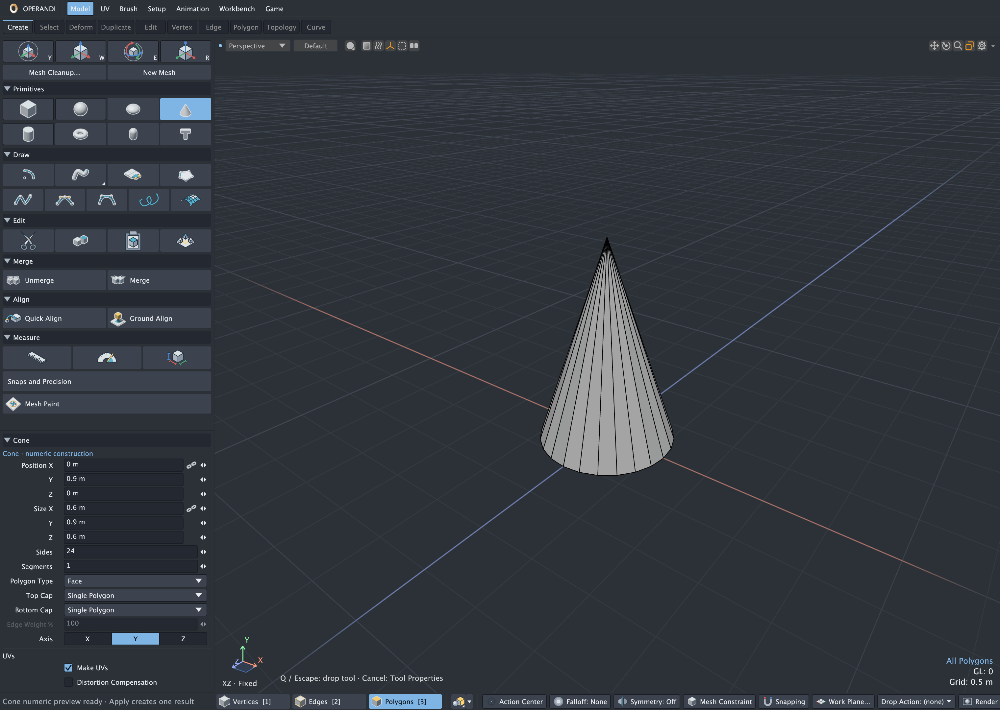

<!-- help-ids: Cone, prim.cone, Cone Unit, Cone New Unit ; template: tool ; since: 0.1.0 -->
# Cone

**Cone** adds a cone: a round base that narrows to a point.

## How to use

1. Make sure the mesh you want to add to is selected in the **Items list**.
2. Click **Cone** in the **Primitives** section of the **Create** tool tab.
3. Drag in the **3D view**. The drag draws the cone's base flat on the
   **Work Plane**, centred on where you press.
4. Press on the dot in the middle of the flat base and drag up to give it its height.
5. Fine-tune it: drag its handles, or type values in **Tool Properties**.
6. Press **Q** (or **Esc**), or click **Cone** again, to drop the tool
   and keep the cone.

To draw it the same size in every direction instead, hold **Control** before
you start the drag: the press is the centre and the pointer sets the
size.

## Without a drag

- **Shift**-click **Cone** adds a 1 m cone as a new mesh item at
  the scene's origin.
- **Control**-click **Cone** adds a 1 m cone to the selected mesh, at
  its origin.

## Properties

| Name | What it does | Default |
|---|---|---|
| **Position** | Where the centre is (X, Y, Z). | 0 m |
| **Size** | Half the size along X, Y and Z; along the **Axis** it is half the height. | 0.5, 0.75, 0.5 m |
| **Sides** | How many polygons go round the axis. | 24 |
| **Segments** | How many rows of polygons go from base to tip. | 1 |
| **Polygon Type** | **Face**, **Subdivs** or **Catmull Clark** polygons. | Face |
| **Top Cap**, **Bottom Cap** | How each end is closed: **None**, **Single Polygon**, **Quad Grid** or **Radial** (**Radial** only for the bottom; it is greyed for the top). | Single Polygon |
| **Edge Weight %** | How sharp the rim stays when the polygons are subdivided. Greyed with **Face** polygons. | 100 |
| **Axis** | The axis from base to tip. | Y |
| **Make UVs** | Gives the shape a UV layout in the **Texture** UV map, for textures. | On |
| **Distortion Compensation** | Keeps UV tiles in proportion to the polygons' sizes. | Off |
| **Gaps %** | Space left round the UV layout. | 0 |
| **UV Map** | Which UV map gets the layout. | Texture |
| **Min**, **Max** | The lowest and highest corner. | from Position and Size |

- **Apply** adds the cone to the mesh and keeps the tool, so you can
  make another.
- **Drop** adds it and closes the tool.
- **Cancel** throws the preview away.
- **Reset** puts every value back to its starting value.

## Related

- [Primitives](../interface/window.md): the **Toolbox** on the **Create** tab
- [Interface](../interface/window.md): the **Work Plane** and **Tool Properties**
- [Cylinder](cylinder.md)
