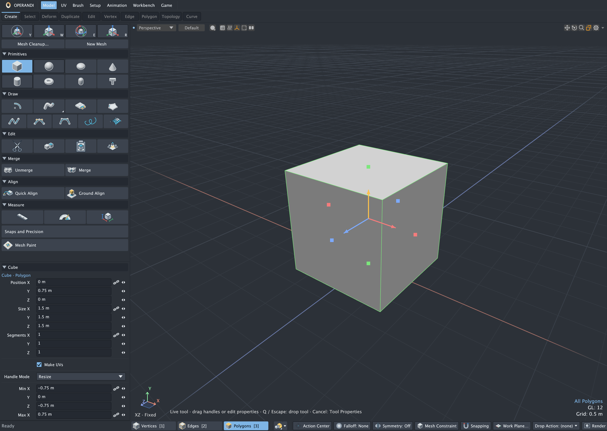

<!-- help-ids: Cube, prim.cube, Cube Unit, Cube New Unit ; template: tool ; since: 0.1.0 -->
# Cube

**Cube** adds a box: six sides, each split into as many rows of polygons as you ask for.

## How to use

1. Make sure the mesh you want to add to is selected in the **Items list**.
2. Click **Cube** in the **Primitives** section of the **Create** tool tab.
3. Drag in the **3D view**. The drag draws the cube's base flat on the
   **Work Plane**, from where you press to where you let go.
4. Drag the handle on top of the flat base up or down to give it its height.
5. Fine-tune it: drag its handles, or type values in **Tool Properties**.
6. Press **Q** (or **Esc**), or click **Cube** again, to drop the tool
   and keep the cube.

To draw it the same size in every direction instead, hold **Control** before
you start the drag: the press is the centre and the pointer sets the
size.

## Without a drag

- **Shift**-click **Cube** adds a 1 m cube as a new mesh item at
  the scene's origin.
- **Control**-click **Cube** adds a 1 m cube to the selected mesh, at
  its origin.

## Handles

| Handle | Drag it to |
|---|---|
| Square on a side | Move that side; the box grows or shrinks (see **Handle Mode**) |
| Arrows in the middle | Move the whole box |

## Properties

| Name | What it does | Default |
|---|---|---|
| **Position** | Where the box's centre is (X, Y, Z). | 0 m |
| **Size** | How big the box is along X, Y and Z. A size of 0 makes one flat polygon. | 1 m |
| **Segments** | How many rows of polygons each side has, along X, Y and Z. | 1 |
| **Make UVs** | Gives the shape a UV layout in the **Texture** UV map, for textures. | On |
| **Handle Mode** | What a side handle does: **Resize** moves only that side; **Resize from Center** moves both opposite sides; **Move All** moves the box. | Resize |
| **Min**, **Max** | The box's lowest and highest corner. Type here to place a side exactly. | from Position and Size |

Rows in grey aren't available yet; they show their value only. They are **Radius**, **Radius Segments**, **Sharp**, **Bulge** and **Axis** (rounded corners), **Distortion Compensation**, **Gaps**, **Show Corner**, and **Apply**.

- **Reset Tool Attributes** puts **Sides** and **Segments** back to their
  starting values; later uses start from them too.
- **Drop Tool** keeps the cube and closes the tool. **Cancel** takes
  back the last change.

## Tips

- A negative **Size** gives the same box as a positive one.
- Change **Segments** before you add bevels or loops, so the sides already
  have the rows you need.

## Related

- [Primitives](../interface/window.md): the **Toolbox** on the **Create** tab
- [Interface](../interface/window.md): the **Work Plane** and **Tool Properties**
- [Sphere](sphere.md), [Cylinder](cylinder.md)
