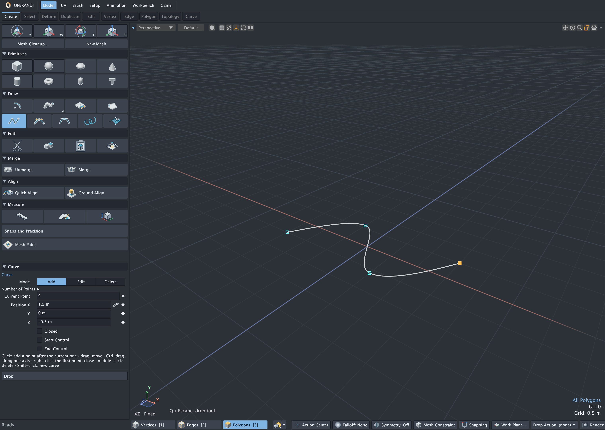

<!-- help-ids: Curve, prim.curve ; template: tool ; since: 0.1.0 -->
# Curve

**Curve** draws a smooth curve that passes through every point you click.

## How to use

1. Make sure the mesh you want to work on is selected in the **Items list**.
2. Click **Curve** in the **Draw** section of the **Create** tool tab.
3. In the **3D view**:
   
   - Click to add a point after the current one.
   - Drag a point to move it; **Control**+drag keeps it on one axis.
   - Right-click the first point to close the curve.
   - Middle-click a point to delete it.
   - **Shift**-click to start a new curve.
4. Press **Q**, or click **Drop**, to keep it and close the tool.

## Properties

| Name | What it does | Default |
|---|---|---|
| **Mode** | What a click does: **Add** points, **Edit** them, or **Delete** them. | Add |
| **Current Point** | Which point the **Position** fields edit. | the last one |
| **Position** | The current point's place (X, Y, Z). | where you clicked |
| **Closed** | Joins the last point back to the first. | Off |
| **Start Control**, **End Control** | Makes the first or last point a control point that shapes the curve without being on it. | Off |

## Related

- [Interface](../interface/window.md): the **Toolbox** and **Tool Properties**
- [Bezier](bezier.md), [B-Spline](b-spline.md), [Sketch](sketch.md)
