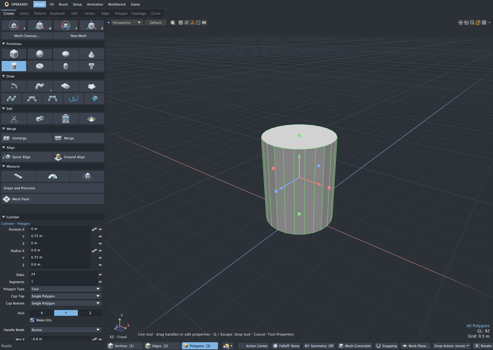

<!-- help-ids: Cylinder, prim.cylinder, Cylinder Unit, Cylinder New Unit ; template: tool ; since: 0.1.0 -->
# Cylinder

**Cylinder** adds a tube with closed ends: rings of polygons round an axis.

## How to use

1. Make sure the mesh you want to add to is selected in the **Items list**.
2. Click **Cylinder** in the **Primitives** section of the **Create** tool tab.
3. Drag in the **3D view**. The drag draws the cylinder's base flat on the
   **Work Plane**, from where you press to where you let go.
4. Drag a side handle to give the flat draft its height, or type its **Radius**.
5. Fine-tune it: drag its handles, or type values in **Tool Properties**.
6. Press **Q** (or **Esc**), or click **Cylinder** again, to drop the tool
   and keep the cylinder.

To draw it the same size in every direction instead, hold **Control** before
you start the drag: the press is the centre and the pointer sets the
size.

## Without a drag

- **Shift**-click **Cylinder** adds a 1 m cylinder as a new mesh item at
  the scene's origin.
- **Control**-click **Cylinder** adds a 1 m cylinder to the selected mesh, at
  its origin.

## Handles

| Handle | Drag it to |
|---|---|
| Square on a side | Change the **Radius** along that axis; hold **Control** to move the cylinder instead |
| Arrows in the middle | Move the cylinder |

## Properties

| Name | What it does | Default |
|---|---|---|
| **Position** | Where the centre is (X, Y, Z). | 0 m |
| **Radius** | Half the size along X, Y and Z; along the **Axis** it is half the height. | 0.5, 0.75, 0.5 m |
| **Sides** | How many polygons go round the axis. | 24 |
| **Segments** | How many rows of polygons go from end to end. | 1 |
| **Polygon Type** | The kind of polygons made. | Face |
| **Cap Top**, **Cap Bottom** | How each end is closed: **None**, **Single Polygon**, **Quads** or **Radial**. | Single Polygon |
| **Axis** | The axis from end to end. | Y |
| **Make UVs** | Gives the shape a UV layout in the **Texture** UV map, for textures. | On |
| **Handle Mode** | Side handles resize that side. | Resize |
| **Min**, **Max** | The lowest and highest corner. | from Position and Radius |

Rows in grey aren't available yet; they show their value only. They are **Edge Weight**, **Distortion Compensation**, **Gaps** and **Show Corner**.

- **Reset Tool Attributes** puts **Sides** and **Segments** back to their
  starting values; later uses start from them too.
- **Drop Tool** keeps the cylinder and closes the tool. **Cancel** takes
  back the last change.

## Tips

- **Cap Top** set to **None** leaves that end open, for a pipe or a cup.

## Related

- [Primitives](../interface/window.md): the **Toolbox** on the **Create** tab
- [Interface](../interface/window.md): the **Work Plane** and **Tool Properties**
- [Cone](cone.md), [Tube](tube.md)
