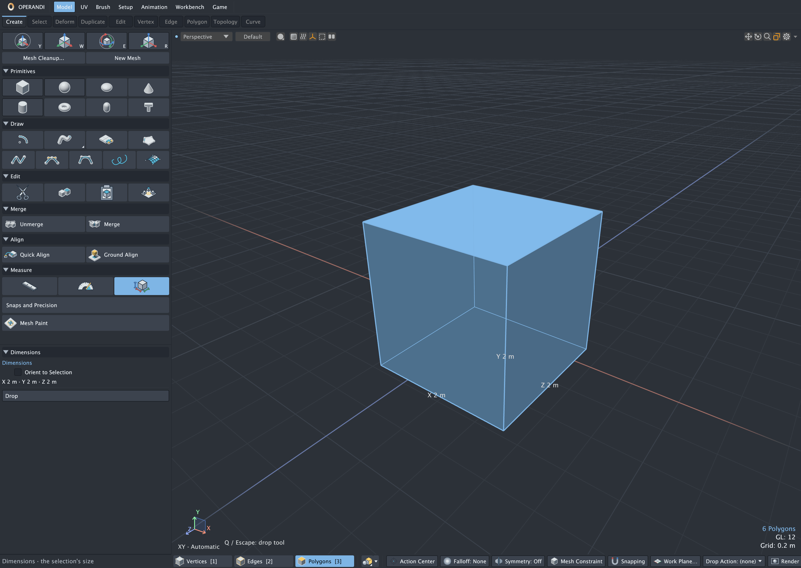

<!-- help-ids: Dimensions ; template: tool ; since: 0.1.0 -->
# Dimensions

**Dimensions** shows how big the selection is along X, Y and Z.

## How to use

1. Make sure the mesh you want to work on is selected in the **Items list**.
2. Click **Dimensions** in the **Measure** section of the **Create** tool tab.
3. Select what you want to measure. The sizes appear along its edges in
   the view, and in **Tool Properties**.
4. Press **Q**, or click **Drop**, to keep it and close the tool.

## Properties

| Name | What it does | Default |
|---|---|---|
| **Orient to Selection** | Measures along the selection's own directions instead of the world's X, Y and Z. | Off |

## Related

- [Interface](../interface/window.md): the **Toolbox** and **Tool Properties**
- [Ruler](ruler.md), [Protractor](protractor.md)
