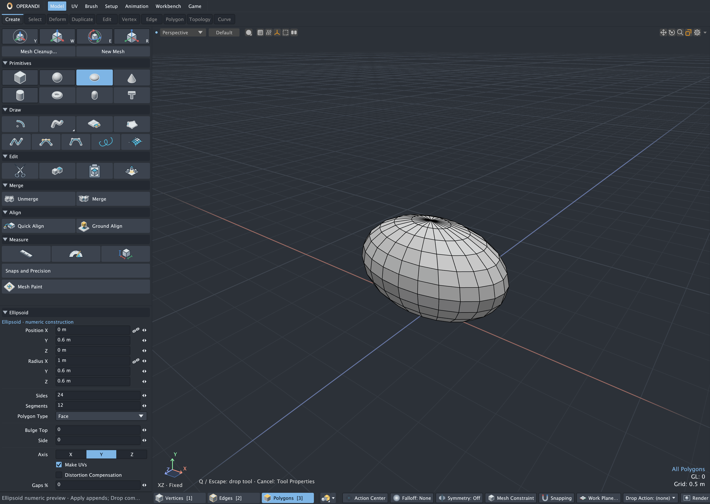

<!-- help-ids: Ellipsoid, prim.ellipsoid, Ellipsoid Unit, Ellipsoid New Unit ; template: tool ; since: 0.1.0 -->
# Ellipsoid

**Ellipsoid** adds a rounded ball with its own size along each axis, which you can push toward a box shape with **Bulge**.

## How to use

1. Make sure the mesh you want to add to is selected in the **Items list**.
2. Click **Ellipsoid** in the **Primitives** section of the **Create** tool tab.
3. Drag in the **3D view**. The drag draws the ellipsoid's base flat on the
   **Work Plane**, centred on where you press.
4. Press on the dot in the middle of the flat base and drag up to give it its height.
5. Fine-tune it: drag its handles, or type values in **Tool Properties**.
6. Press **Q** (or **Esc**), or click **Ellipsoid** again, to drop the tool
   and keep the ellipsoid.

To draw it the same size in every direction instead, hold **Control** before
you start the drag: the press is the centre and the pointer sets the
size.

## Without a drag

- **Shift**-click **Ellipsoid** adds a 1 m ellipsoid as a new mesh item at
  the scene's origin.
- **Control**-click **Ellipsoid** adds a 1 m ellipsoid to the selected mesh, at
  its origin.

## Properties

| Name | What it does | Default |
|---|---|---|
| **Position** | Where the centre is (X, Y, Z). | 0 m |
| **Radius** | Half the size along X, Y and Z. | 0.5 m |
| **Sides** | How many polygons go round the axis. | 24 |
| **Segments** | How many rings go from pole to pole. | 12 |
| **Polygon Type** | **Face**, **Subdivs** or **Catmull-Clark** polygons. | Face |
| **Bulge Top** | Flattens the ends toward a box shape. | 0 |
| **Side** | Pushes the sides out toward a box shape. | 0 |
| **Axis** | The axis the poles sit on. | Y |
| **Make UVs** | Gives the shape a UV layout in the **Texture** UV map, for textures. | On |
| **Distortion Compensation** | Keeps UV tiles in proportion to the polygons' sizes. | Off |
| **Gaps %** | Space left round the UV layout. | 0 |
| **Min**, **Max** | The lowest and highest corner. | from Position and Radius |
| **UV Map** | Which UV map gets the layout. | Texture |
| **Numeric Symmetry** | Makes the shape symmetric along X, Y or Z. | Off |

- **Apply** adds the ellipsoid to the mesh and keeps the tool, so you can
  make another.
- **Drop** adds it and closes the tool.
- **Cancel** throws the preview away.
- **Reset** puts every value back to its starting value.

## In the Mesh Stack

You can also add a Ellipsoid as a step of a mesh's **Mesh Stack**: choose
**Ellipsoid** under **Create > Primitives** in the stack's **Add Operator**
list. It has the same properties as the tool, and the tool and the stack
step build exactly the same ellipsoid from the same values, so you can
change it later without rebuilding the mesh. **Min**, **Max** and
**Numeric Symmetry** aren't there; use a **Symmetrize** step for symmetry. Scripts
add it with `meshop.create type:prim.ellipsoid.item`.

## Related

- [Primitives](../interface/window.md): the **Toolbox** on the **Create** tab
- [Interface](../interface/window.md): the **Work Plane** and **Tool Properties**
- [Sphere](sphere.md)
