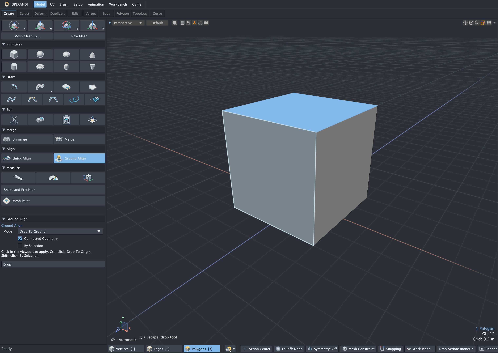

<!-- help-ids: Ground Align, GroundAlign ; template: tool ; since: 0.1.0 -->
# Ground Align

**Ground Align** drops geometry onto the ground, or to the origin, with one click.

## How to use

1. Make sure the mesh you want to work on is selected in the **Items list**.
2. Click **Ground Align** in the **Align** section of the **Create** tool tab.
3. Click in the **3D view**. The selection (or, with nothing selected, the
   whole mesh) drops so its lowest point rests on the ground.
4. Press **Q**, or click **Drop**, to keep it and close the tool.

**Control**-click drops it to the origin instead; **Shift**-click works by
the selection.

## Properties

| Name | What it does | Default |
|---|---|---|
| **Mode** | **Drop To Ground**, **Drop To Origin** or **Rotate To Ground**. | Drop To Ground |
| **Connected Geometry** | Moves everything connected to the selection too. Always on with nothing selected. | On |
| **By Selection** | Uses the selection's lowest point, not the whole piece's. | Off |

## Related

- [Interface](../interface/window.md): the **Toolbox** and **Tool Properties**
- [Quick Align](quick-align.md)
