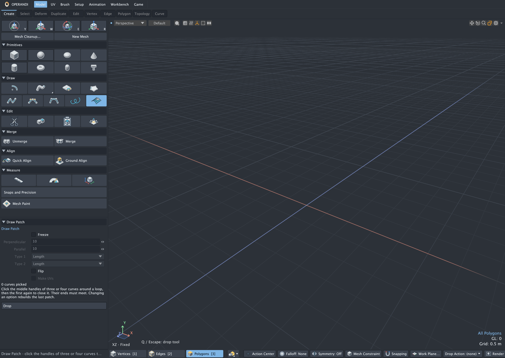

<!-- help-ids: Draw Patch, patch.draw ; template: tool ; since: 0.1.0 -->
# Patch

**Patch** fills the space between three or four curves that meet end to end with a grid of polygons.

## How to use

1. Make sure the mesh you want to work on is selected in the **Items list**.
2. Click **Patch** in the **Draw** section of the **Create** tool tab.
3. Click the middle handle of each curve round the loop, in order: three or
   four curves whose ends meet.
4. Click the first curve again to close the loop. The patch appears.
5. Press **Q**, or click **Drop**, to keep it and close the tool.

Draw the curves first, with [Curve](curve.md), [Bezier](bezier.md) or
[B-Spline](b-spline.md).

## Properties

| Name | What it does | Default |
|---|---|---|
| **Freeze** | On: the patch becomes ordinary polygons. Off: one live patch polygon that follows its curves. | Off |
| **Perpendicular**, **Parallel** | How many rows of polygons across the patch and along the first picked curve. Greyed until **Freeze** is on. | 10, 10 |
| **Type 1**, **Type 2** | How the rows are spaced: **Length** (evenly along the curve) or **Knot** (evenly between the curve's points). | Length |
| **Flip** | Turns the patch to face the other way. | Off |
| **Make UVs** | Gives a frozen patch a grid of UVs. | Off |

## Related

- [Interface](../interface/window.md): the **Toolbox** and **Tool Properties**
- [Curve](curve.md)
