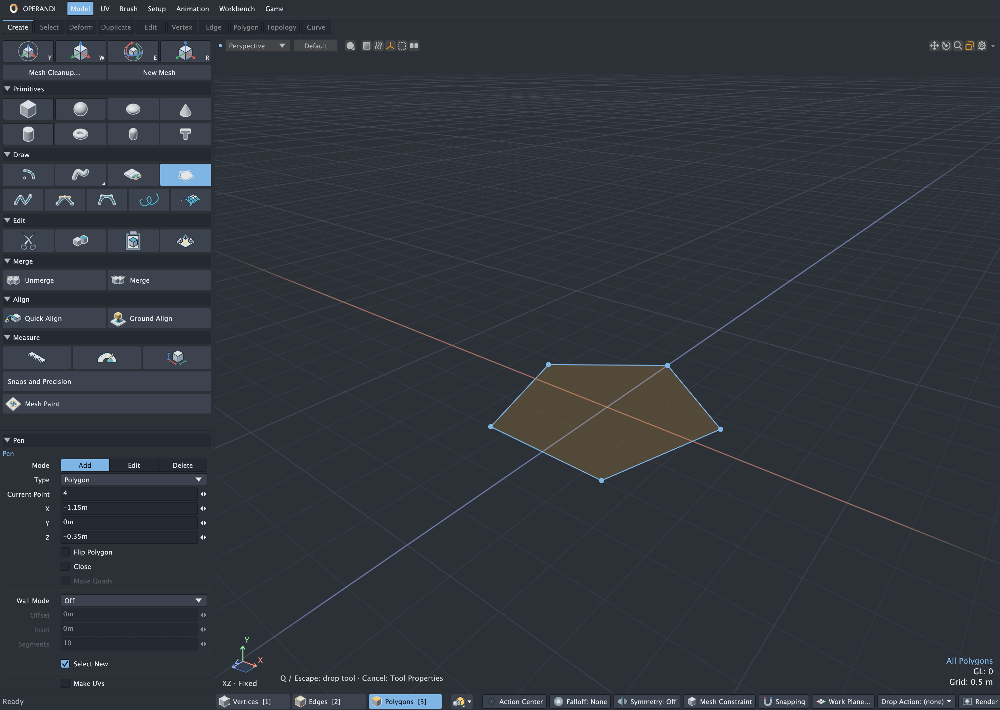

<!-- help-ids: Polygon Pen, prim.pen ; template: tool ; since: 0.1.0 -->
# Pen

**Pen** makes a polygon, or a string of points or a line, from points you click one by one.

## How to use

1. Make sure the mesh you want to work on is selected in the **Items list**.
2. Click **Pen** in the **Draw** section of the **Create** tool tab.
3. Click in the **3D view** to place each point. The polygon follows the
   points in the order you click them.
4. **Shift**-click to start the next polygon.
5. Press **Q**, or click **Drop**, to keep it and close the tool.

## Properties

| Name | What it does | Default |
|---|---|---|
| **Mode** | What a click does: **Add** points, **Edit** them, or **Delete** them. | Add |
| **Type** | What the points make: **Polygon**, **Vertices**, **Subdivision**, **Polyline**, **Catmull-Clark** or **B-Spline**. (**Spline Patch** is greyed: not available yet.) | Polygon |
| **Current Point** | Which point the X, Y and Z fields edit. | the last one |
| **X**, **Y**, **Z** | The current point's position. | where you clicked |
| **Flip Polygon** | Reverses the new polygons so they face the other way. | Off |
| **Close** | Joins the last point back to the first (for **Polyline** and walls). | Off |
| **Make Quads** | Click a starting edge, then each click adds a quad. **Control**-click ends the strip with a triangle; **Shift**-click starts a new strip. | Off |
| **Wall Mode** | Turns the clicked path into a wall strip: **Off**, **Both Sides**, **Inner** or **Outer**. Right-drag sets **Offset**. | Off |
| **Offset**, **Inset**, **Segments** | The wall's distance, inset and rows. Greyed until you choose a **Wall Mode**. | 0 m, 0 m, 10 |
| **Select New** | Selects the new element when you drop the tool. | On |
| **Make UVs** | Gives the new polygon a UV layout. | Off |

**Merge**, **Show Angles**, **Show Handles** and **Show Numbers** are greyed: not available yet.

## Related

- [Interface](../interface/window.md): the **Toolbox** and **Tool Properties**
- [Topology Pen](topology-pen.md), [Curve](curve.md)
