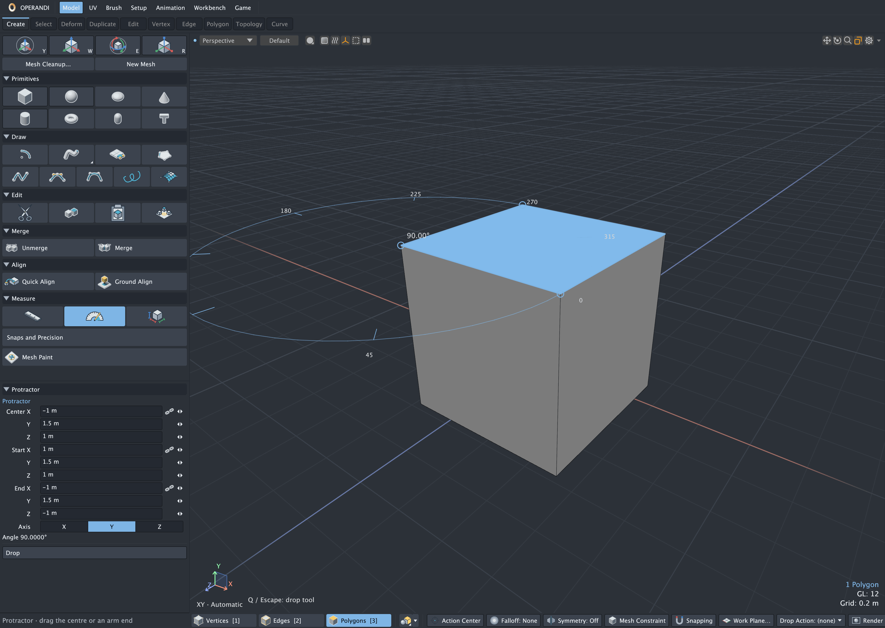

<!-- help-ids: Protractor, util.protractor ; template: tool ; since: 0.1.0 -->
# Protractor

**Protractor** measures the angle between two arms that meet at a centre.

## How to use

1. Make sure the mesh you want to work on is selected in the **Items list**.
2. Click **Protractor** in the **Measure** section of the **Create** tool tab.
3. Drag the centre to the corner you want to measure, then drag each arm's
   end along an edge.
4. Read the angle in the view, or in **Tool Properties**.
5. Press **Q**, or click **Drop**, to keep it and close the tool.

## Properties

| Name | What it does | Default |
|---|---|---|
| **Center** | Where the two arms meet (X, Y, Z). |  |
| **Start**, **End** | Where the arms end (X, Y, Z). |  |
| **Axis** | The axis the protractor lies across. | Y |

Under the fields, **Angle** gives the angle between the arms.

## Related

- [Interface](../interface/window.md): the **Toolbox** and **Tool Properties**
- [Ruler](ruler.md), [Dimensions](dimensions.md)
