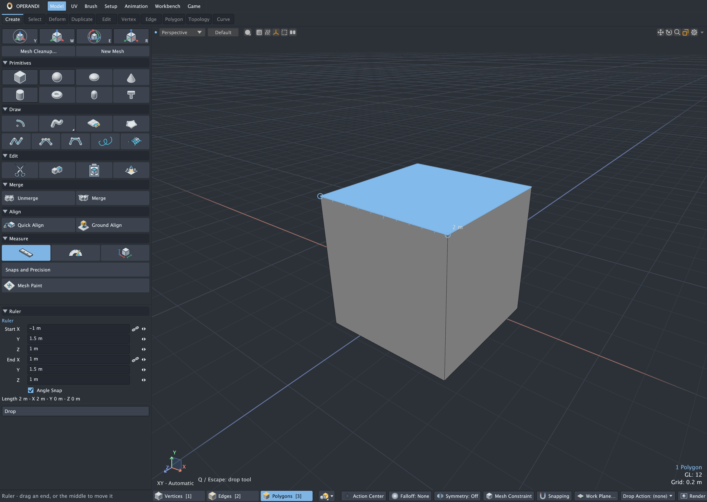

<!-- help-ids: Ruler, util.ruler ; template: tool ; since: 0.1.0 -->
# Ruler

**Ruler** measures the distance between two points. Its ends snap to points of your meshes.

## How to use

1. Make sure the mesh you want to work on is selected in the **Items list**.
2. Click **Ruler** in the **Measure** section of the **Create** tool tab.
3. A 200 mm ruler appears in the middle of the view, on the **Work Plane**.
4. Drag each end to a point you want to measure; drag the middle to move
   the whole ruler.
5. Read the length next to the ruler, or in **Tool Properties**.
6. Press **Q**, or click **Drop**, to keep it and close the tool.

## Properties

| Name | What it does | Default |
|---|---|---|
| **Start**, **End** | Where the ruler's ends are (X, Y, Z). | a 0.2 m ruler along X |
| **Angle Snap** | Snaps the ruler's direction to steps of angle while you drag. | On |

Under the fields, **Length** gives the distance and its X, Y and Z parts.

## Related

- [Interface](../interface/window.md): the **Toolbox** and **Tool Properties**
- [Protractor](protractor.md), [Dimensions](dimensions.md)
