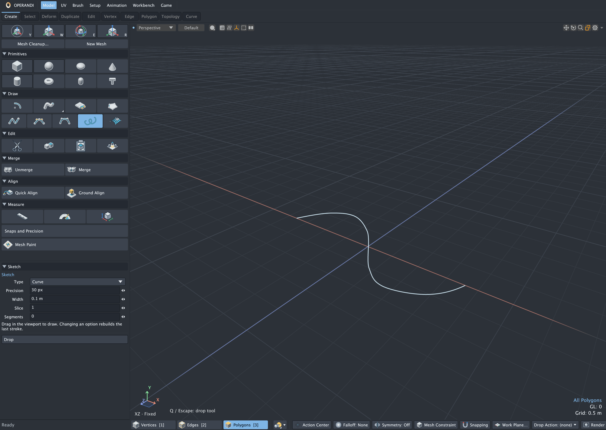

<!-- help-ids: Sketch, prim.sketch ; template: tool ; since: 0.1.0 -->
# Sketch

**Sketch** turns a freehand stroke into a curve, a strip of polygons or a single polygon.

## How to use

1. Make sure the mesh you want to work on is selected in the **Items list**.
2. Click **Sketch** in the **Draw** section of the **Create** tool tab.
3. Drag in the **3D view** to draw a stroke.
4. Change the options in **Tool Properties**: the last stroke is rebuilt
   with them.
5. Press **Q**, or click **Drop**, to keep it and close the tool.

## Properties

| Name | What it does | Default |
|---|---|---|
| **Type** | What the stroke makes: **Curve**, **Face** (one polygon), **Lines**, **Quads** (a strip), **Bezier** or **B-Spline**. | Curve |
| **Precision** | How far the pointer moves, in screen pixels, between two points of the stroke. | 30 px |
| **Width** | **Quads**: how wide the strip is. | 0.1 m |
| **Slice** | **Quads**: how many rows of polygons across the strip. | 1 |
| **Segments** | Keeps only this many segments from the start; 0 keeps them all. | 0 |

## Related

- [Interface](../interface/window.md): the **Toolbox** and **Tool Properties**
- [Curve](curve.md)
